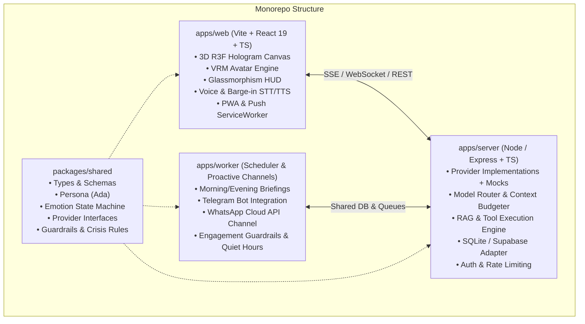

# Master Plan: Ada AI GF Assistant

> **Status:** Phase 1 in progress  
> **Repository:** `priyanrajj-hub/ai---gf---assistant-`  
> **Master Specification:** [`ADA_MASTER_PROMPT.md`](./ADA_MASTER_PROMPT.md)  
> **Project Rules:** [`GEMINI.md`](./GEMINI.md)

---

## 1. System Architecture

### Provider Architecture (All swappable with working local mocks)
- `LLMProvider`: Gemini (`gemini-2.5-flash` / `gemini-2.5-pro`), Claude, and `MockLLMProvider`
- `STTProvider`: Web Speech API (Client), Whisper API (Server), and `MockSTTProvider`
- `TTSProvider`: ElevenLabs, Google Cloud Neural, Browser SpeechSynthesis, and `MockTTSProvider`
- `SearchProvider`: Tavily / DuckDuckGo / Brave, and `MockSearchProvider`
- `MemeProvider`: Reddit API, Imgflip API, Tenor/Giphy, and `MockMemeProvider`
- `ChannelProvider`: In-App / PWA Web Push, Telegram Bot, WhatsApp Cloud API, and `MockChannelProvider`
- `VisionProvider`: Gemini Vision / Multimodal analysis, and `MockVisionProvider`

---

## 2. Implementation Phase Checklist

- [ ] **Phase 1: Scaffold, Auth, DB & Provider Interfaces with Mocks**
  - [ ] Monorepo structure setup (`/apps/web`, `/apps/server`, `/apps/worker`, `/packages/shared`)
  - [ ] Shared package with full TypeScript types, schemas (Zod/JSON schema), and provider interfaces
  - [ ] Standalone database adapter (SQLite with pgvector abstraction, ready for Supabase)
  - [ ] Provider implementations with working offline mocks for zero-key local development
  - [ ] Authentication middleware and data isolation (guest/local session + Supabase/Clerk adapter)
  - [ ] Root `.env.example` and scripts

- [ ] **Phase 2: Text Chat with LLM, Streaming & Context Builder**
  - [ ] System prompt with Ada persona, strict relationship guardrails, and India crisis protocols
  - [ ] Model router (cheap/fast model for chat/voice, pro model for reasoning)
  - [ ] Context builder with token budgeting (~800 persona, ~600 memory, ~2k turns, ~2k tools)
  - [ ] Streaming response engine with structured JSON parsing & repair (`{ speech, display_text, emotion, intensity, gesture, voice_style, actions }`)
  - [ ] Cost & token usage logger with 80% warning and 100% budget downgrade

- [ ] **Phase 3: 3D Hologram Scene, Custom Shader & Avatar Loading**
  - [ ] Three.js / React Three Fiber scene with metallic projector base, glowing rings, and volumetric light cone
  - [ ] Custom Hologram Shader with fresnel rim glow, upward scanlines, flicker, transparency, and glitch
  - [ ] Bloom postprocessing and floating particles
  - [ ] Dynamic VRM loader (`/public/models/ada.vrm`) with fallback procedural holographic figure
  - [ ] Natural procedural idle animation loop (breathing, soft blinking, eye saccades, weight shift)
  - [ ] Head and eye tracking with smooth mouse/touch slerp damping

- [ ] **Phase 4: Emotion Engine & Gestures**
  - [ ] Emotion state machine with 10 states: `happy`, `sad`, `excited`, `concerned`, `thinking`, `surprised`, `playful`, `calm`, `motivated`, `tired`
  - [ ] Gradual mood decay/blending memory (smooth transitions)
  - [ ] VRM blendshape mapping + body gesture poses (nod, tilt, thinking, wave, motivate fist pump)
  - [ ] Dynamic hologram aura color shifting based on active emotion

- [ ] **Phase 5: Voice Interaction (STT, TTS, Lip-Sync, Barge-In)**
  - [ ] Push-to-talk and Hands-Free continuous voice mode with wake-word hook
  - [ ] Audio visualizer HUD (circular arc-reactor and waveform oscilloscope)
  - [ ] Audio Analyser lip-sync driving VRM mouth blendshapes (A, I, U, E, O)
  - [ ] Instant barge-in: cancel speech synthesis the millisecond user speaks
  - [ ] Multilingual support (English, Hindi, Hinglish) with language auto-detect

- [ ] **Phase 6: Long-Term Memory & Memory Manager**
  - [ ] Short-term rolling buffer + long-term memory store (facts, preferences, goals, dates)
  - [ ] Strict consent gate: sensitive categories (health, finance) blocked unless explicitly asked
  - [ ] Memory Manager UI: view, search, edit, delete individual memories, pin, export JSON, and "forget everything" button
  - [ ] Nightly consolidation job to summarize and deduplicate

- [ ] **Phase 7: Agentic Tools Suite**
  - [ ] Web search tool with source citations and prompt-injection defense
  - [ ] Weather, news, and interest profile tuning
  - [ ] Focus / Pomodoro timer with hologram HUD countdown
  - [ ] Notes and To-Do list with voice command integration
  - [ ] Sandboxed calculator & unit converter
  - [ ] Dynamic mode switcher tool (Jarvis, Mentor, Coder, Coach, Listener, Playful)

- [ ] **Phase 8: Meme Module & Humor Engine**
  - [ ] Reddit API / Imgflip / Giphy integration with safe-search and blocklist
  - [ ] Mood-sensitive meme matching (never send jokes/memes when user is upset)
  - [ ] Imgflip custom template caption generator
  - [ ] Mock meme provider with curated high-quality developer and wholesome companion memes

- [ ] **Phase 9: PWA Push, Scheduler & Briefings**
  - [ ] Service worker with PWA manifest (installable on desktop and mobile)
  - [ ] Web Push notification infrastructure with VAPID keys
  - [ ] Background worker scheduler for Morning Briefing, Midday Nudge, Evening Wrap-up, and Weekly Reflection
  - [ ] Engagement guardrails: quiet hours (11pm-7am), max 3 proactive messages/day, snooze & mute commands

- [ ] **Phase 10: Channels (Telegram Bot & WhatsApp Cloud API)**
  - [ ] Telegram Bot with voice note transcription in and TTS out
  - [ ] Official WhatsApp Business Cloud API webhook and template message dispatcher
  - [ ] Shared persona and unified memory across all channels

- [ ] **Phase 11: Vision, Settings, Accessibility & Glassmorphism UI**
  - [ ] "Explain this screen / file" multimodal upload (PDF/images)
  - [ ] Optional client camera vision reaction (off by default, strictly on-device/ephemeral)
  - [ ] Full-screen hologram mode, HUD toggle, personality sliders (humor, warmth, formality, directness, flirtiness, talkativeness)
  - [ ] Futuristic cyber-glassmorphism design with accessibility (reduced motion, screen reader, captions)

- [ ] **Phase 12: Evals Suite, Security Review, Docker & Deployment**
  - [ ] `/evals` suite with 50+ test conversations (crisis checks, relationship guardrails, persona consistency)
  - [ ] Security auditing: CORS, rate limiting, helmet, input sanitization
  - [ ] Dockerfile and docker-compose.yml for 1-click startup
  - [ ] Complete README with architecture, setup, env vars, and deployment guides

---

## 3. Needs From Me (Optional External Keys & Assets)

Everything is built with working local mocks so the application works out of the box with zero external configuration. When you are ready to connect live cloud services, supply:

1. **LLM API Key:** Google Gemini API Key (`GEMINI_API_KEY`) from [Google AI Studio](https://aistudio.google.com/) (recommended & free), or Anthropic API Key (`ANTHROPIC_API_KEY`).
2. **Text-to-Speech (Optional):** ElevenLabs API Key (`ELEVENLABS_API_KEY`) & Voice ID for hyper-realistic neural voice (browser speech synthesis is enabled as default free fallback).
3. **Search (Optional):** Tavily API Key (`TAVILY_API_KEY`) or Brave Search Key (DuckDuckGo mock/proxy is active by default).
4. **Channels (Optional):**
   - Telegram Bot Token from `@BotFather`
   - WhatsApp Cloud API Meta token & Phone Number ID
   - Supabase project URL & Service Key (if upgrading from local SQLite to hosted Supabase)
5. **Custom VRM Avatar (Optional):** Drop your custom `.vrm` file into `apps/web/public/models/ada.vrm` (or upload via Settings).
