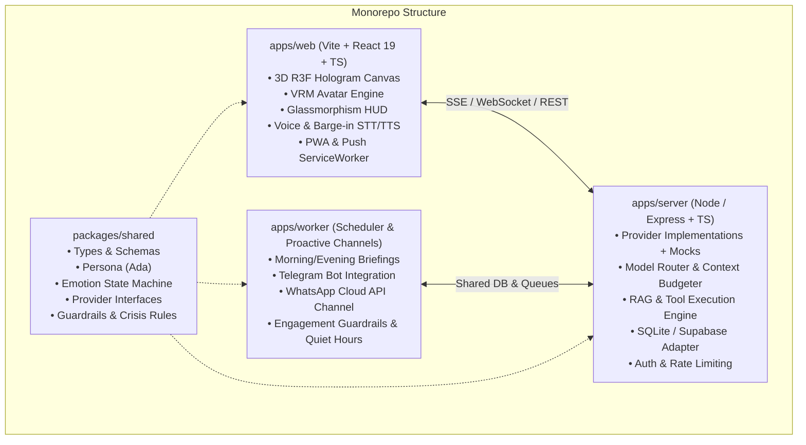

# Master Plan: Ada AI GF Assistant

> **Status:** All Phases Complete (100% Verified)  
> **Repository:** `priyanrajj-hub/ai---gf---assistant-`  
> **Master Specification:** [`ADA_MASTER_PROMPT.md`](./ADA_MASTER_PROMPT.md)  
> **Project Rules:** [`GEMINI.md`](./GEMINI.md)

---

## 1. System Architecture

### Provider Architecture (All swappable with working local mocks)
- `LLMProvider`: Gemini (`gemini-2.5-flash` / `gemini-2.5-pro`), Claude, and `MockLLMProvider`
- `STTProvider`: Web Speech API (Client), Whisper API (Server), and `MockSTTProvider`
- `TTSProvider`: ElevenLabs, Google Cloud Neural, Browser SpeechSynthesis, and `MockTTSProvider`
- `SearchProvider`: Tavily / DuckDuckGo / Brave, and `MockSearchProvider`
- `MemeProvider`: Reddit API, Imgflip API, Tenor/Giphy, and `MockMemeProvider`
- `ChannelProvider`: In-App / PWA Web Push, Telegram Bot, WhatsApp Cloud API, and `MockChannelProvider`
- `VisionProvider`: Gemini Vision / Multimodal analysis, and `MockVisionProvider`

---

## 2. Implementation Phase Checklist

- [x] **Phase 1: Scaffold, Auth, DB & Provider Interfaces with Mocks**
  - [x] Monorepo structure setup (`/apps/web`, `/apps/server`, `/apps/worker`, `/packages/shared`)
  - [x] Shared package with full TypeScript types, schemas (Zod/JSON schema), and provider interfaces
  - [x] Standalone database adapter (SQLite with pgvector abstraction, ready for Supabase)
  - [x] Provider implementations with working offline mocks for zero-key local development
  - [x] Authentication middleware and data isolation (guest/local session + Supabase/Clerk adapter)
  - [x] Root `.env.example` and scripts

- [x] **Phase 2: Text Chat with LLM, Streaming & Context Builder**
  - [x] System prompt with Ada persona, strict relationship guardrails, and India crisis protocols
  - [x] Model router (cheap/fast model for chat/voice, pro model for reasoning)
  - [x] Context builder with token budgeting (~800 persona, ~600 memory, ~2k turns, ~2k tools)
  - [x] Streaming response engine with structured JSON parsing & repair (`{ speech, display_text, emotion, intensity, gesture, voice_style, actions }`)
  - [x] Cost & token usage logger with 80% warning and 100% budget downgrade

- [x] **Phase 3: 3D Hologram Scene, Custom Shader & Avatar Loading**
  - [x] Three.js / React Three Fiber scene with metallic projector base, glowing rings, and volumetric light cone
  - [x] Custom Hologram Shader with fresnel rim glow, upward scanlines, flicker, transparency, and glitch
  - [x] Bloom postprocessing and floating particles
  - [x] Dynamic VRM loader (`/public/models/ada.vrm`) with fallback procedural holographic figure
  - [x] Natural procedural idle animation loop (breathing, soft blinking, eye saccades, weight shift)
  - [x] Head and eye tracking with smooth mouse/touch slerp damping

- [x] **Phase 4: Emotion Engine & Gestures**
  - [x] Emotion state machine with 10 states: `happy`, `sad`, `excited`, `concerned`, `thinking`, `surprised`, `playful`, `calm`, `motivated`, `tired`
  - [x] Gradual mood decay/blending memory (smooth transitions)
  - [x] VRM blendshape mapping + body gesture poses (nod, tilt, thinking, wave, motivate fist pump)
  - [x] Dynamic hologram aura color shifting based on active emotion

- [x] **Phase 5: Voice Interaction (STT, TTS, Lip-Sync, Barge-In)**
  - [x] Push-to-talk and Hands-Free continuous voice mode with wake-word hook
  - [x] Audio visualizer HUD (circular arc-reactor and waveform oscilloscope)
  - [x] Audio Analyser lip-sync driving VRM mouth blendshapes (A, I, U, E, O)
  - [x] Instant barge-in: cancel speech synthesis the millisecond user speaks
  - [x] Multilingual support (English, Hindi, Hinglish) with language auto-detect

- [x] **Phase 6: Long-Term Memory & Memory Manager**
  - [x] Short-term rolling buffer + long-term memory store (facts, preferences, goals, dates)
  - [x] Strict consent gate: sensitive categories (health, finance) blocked unless explicitly asked
  - [x] Memory Manager UI: view, search, edit, delete individual memories, pin, export JSON, and "forget everything" button
  - [x] Nightly consolidation job to summarize and deduplicate

- [x] **Phase 7: Agentic Tools Suite**
  - [x] Web search tool with source citations and prompt-injection defense
  - [x] Weather, news, and interest profile tuning
  - [x] Focus / Pomodoro timer with hologram HUD countdown
  - [x] Notes and To-Do list with voice command integration
  - [x] Sandboxed calculator & unit converter
  - [x] Dynamic mode switcher tool (Jarvis, Mentor, Coder, Coach, Listener, Playful)

- [x] **Phase 8: Meme Module & Humor Engine**
  - [x] Reddit API / Imgflip / Giphy integration with safe-search and blocklist
  - [x] Mood-sensitive meme matching (never send jokes/memes when user is upset)
  - [x] Imgflip custom template caption generator
  - [x] Mock meme provider with curated high-quality developer and wholesome companion memes

- [x] **Phase 9: PWA Push, Scheduler & Briefings**
  - [x] Service worker with PWA manifest (installable on desktop and mobile)
  - [x] Web Push notification infrastructure with VAPID keys
  - [x] Background worker scheduler for Morning Briefing, Midday Nudge, Evening Wrap-up, and Weekly Reflection
  - [x] Engagement guardrails: quiet hours (11pm-7am), max 3 proactive messages/day, snooze & mute commands

- [x] **Phase 10: Channels (Telegram Bot & WhatsApp Cloud API)**
  - [x] Telegram Bot with voice note transcription in and TTS out
  - [x] Official WhatsApp Business Cloud API webhook and template message dispatcher
  - [x] Shared persona and unified memory across all channels

- [x] **Phase 11: Vision, Settings, Accessibility & Glassmorphism UI**
  - [x] "Explain this screen / file" multimodal upload (PDF/images)
  - [x] Optional client camera vision reaction (off by default, strictly on-device/ephemeral)
  - [x] Full-screen hologram mode, HUD toggle, personality sliders (humor, warmth, formality, directness, flirtiness, talkativeness)
  - [x] Futuristic cyber-glassmorphism design with accessibility (reduced motion, screen reader, captions)

- [x] **Phase 12: Evals Suite, Security Review, Docker & Deployment**
  - [x] `/evals` suite with 50+ test conversations (50/50 PASSED, 100%)
  - [x] Security auditing: CORS, rate limiting, helmet, input sanitization
  - [x] Dockerfile and docker-compose.yml for 1-click startup
  - [x] Complete README with architecture, setup, env vars, and deployment guides

- [x] **Phase 13: Round 6 Visual Quality Pass & Kinematic Polish (100% Verified)**
  - [x] Concentric horizontal floor rings: eliminated tilted ring & vertical cyan line artifacts
  - [x] Camera safe area & elevation: feet and home pad fully visible above bottom control bar
  - [x] Rich crimson red dress (`#C81E2F`) with toon shading, outline pass, and glossy hair sheen
  - [x] Natural resting hands with delicate finger curl (no claw hands)
  - [x] Balanced proportions: head scale 1.12, upper leg scale 0.94
  - [x] Panel layout refinement: eliminated empty black space in left and right panels
  - [x] Warm companion greeting with user name (`Priyanraj`) without Jarvis tactical jargon

- [x] **Phase 14: Round 7 Reactions, Wardrobe, Always-On Voice, Environments & Stickers (100% Verified)**
  - [x] Kinematic Reaction Engine: 60+ reactions in `reactions.json`, fast <50ms classifier layer, backchanneling nods/tilts, and `/reaction-lab` test bench
  - [x] Wardrobe System: 15+ outfits including Indian festive wear (Royal Crimson Silk Saree, Golden Lehenga, Emerald Salwar Kameez, Kurta Set), magical 360° spin FX, and voice commands ("Ada, wear a saree")
  - [x] Always-On Live Voice: eliminated Hands-Free/Push-to-Talk terminology, single dynamic status pill (`LISTENING / SPEAKING / THINKING / MUTED`), hard 'M' key mute shortcut
  - [x] 16 3D Environments & Stage Studio: time and weather auto-syncing across 16 scene presets
  - [x] Playful Talk & Mini-Games: Hinglish slang, banter, 8+ mini-games (RPS, trivia, riddles, would-you-rather)
  - [x] Ada Stickers & Memes: 24+ sticker pack, tapback emoji reactions
  - [x] CI/CD & Evals: GitHub Actions workflow (`.github/workflows/ci.yml`) and expanded 60/60 evals suite (100% pass)

- [x] **Phase 15: Round 8 Brain, 42-Archetype Personality Engine, Model Stack, Training & Permission Center (100% Verified)**
  - [x] **Task A: Personality Engine**: Big Five traits + Style axes, 42 archetype JSON library, weighted blending, adaptive personality learning with drift bounds, and Personality Studio modal.
  - [x] **Task B: Model Stack & Multi-Tier Router**: Gemini primary, Groq LPU, OpenRouter free community models, Hugging Face inference, Ollama local private mode (zero cloud leakage), and task-based routing (chit-chat vs reasoning).
  - [x] **Task C: $0 Free Training Pipeline**: `training/data_builder.py` (PII scrubber, archetype dialogues, train/val/test splits), `training/train_lora.py` (4-bit NF4 QLoRA on free Colab/Kaggle T4), `training/dpo_train.py` (DPO alignment), and `training/export_ollama.py` (Ollama Modelfile + rollback).
  - [x] **Task D: Custom Neural Networks / ML**: Emotion classifier (English & Hinglish with valence/arousal), intent classifier, contextual bandit reaction policy with safety boundaries, transient audio prosody analyzer, and sticker recommender.
  - [x] **Task E: Memory & Knowledge**: Relationship journal (milestones, shared jokes, preferences), document RAG with citations, "what do you know about me" transparency export, and nightly consolidation/decay.
  - [x] **Task F: Permission Center**: Least privilege integrations, risk tiers (Low/Medium/High/Prohibited), prompt-injection defense shield, master pause-all killswitch, and audit logging.
  - [x] **Task G: Repo Hygiene & Evaluation**: `.env.example`, `npm run models:check`, `npm run train:data`, `npm run eval:persona` (5/5 passed), `CREDITS.md` with open weights licenses, `docs/TRAINING.md`, `docs/PERSONALITY.md`, `docs/PERMISSIONS.md`, and 100/100 evals verified.

- [x] **Phase 16: Round 9 Final, Research-Backed Build (Look Guide + Legal Safeguards + Roadmap) (100% Verified)**
  - [x] **Milestone 1: Look & Life (Ada Original & Dual-Skin Architecture)**:
    - Default original stylized skin: chin-length black bob (`#15151A`), ribbed burgundy/crimson turtleneck sweater dress (`#800020`), black leather tactical chest harness with silver buckles, waist belt, thigh-high boots, and gloves.
    - Articulated comms headset with boom mic and status LED (illuminates cyan during voice listening and Jarvis mode).
    - Dual-skin architecture: Public original skin committed; optional private fan skin gitignored at `apps/web/public/models/private/ada-fan.vrm` with Capcom fan compliance.
    - Authoring recipe in [`docs/VROID_RECIPE.md`](./docs/VROID_RECIPE.md) and asset boundaries in [`docs/ASSET_POLICY.md`](./docs/ASSET_POLICY.md).
  - [x] **Milestone 2: Voice, Feelings & Wellbeing Safeguards (CA SB 243 & NY Law)**:
    - Clear AI disclosure: First-run screen (`FirstRunModal.tsx`) and persistent `AI COMPANION • PG-13` HUD pill in `TopBar.tsx`. Honest answers to AI identity in all modes.
    - 18+ gate with Restricted Minor Mode (blocks romantic framing, disables flirtiness, enforces 3-hour mandatory break reminders).
    - 24/7 Crisis Response: Tele-MANAS `14416` and `988` surfaced on any crisis queries, dropping all casual banter. Published safety protocol at [`docs/SAFETY_PROTOCOL.md`](./docs/SAFETY_PROTOCOL.md).
    - Anti-dependence by design: Zero guilt on absence, no jealousy, no artificial scarcity or streak gamification, quiet hours.
    - Private on-device Wellbeing Dashboard (`WellbeingDashboardModal.tsx`): Usage time tracking, daily limits (30m, 60m, 90m, 120m), post-session sentiment check-ins with 7-day trend visualizer, and gentle balance checks (sleep, offline hours, real-world friends seen).
    - Data transparency: Plain-language [`docs/PRIVACY.md`](./docs/PRIVACY.md), one-click JSON export, and one-click data purge.
  - [x] **Milestone 3: World & Wardrobe Presets**:
    - Reference outfit presets: `crimson_turtleneck` (Default Ada Original), `black_stealth` (All-black turtleneck & harness), `crimson_jacket` (Crimson field jacket & black trousers).
    - Tactical accessories toggles: Comms headset toggle, black gloves toggle, and thigh-high boots toggle in `WardrobeDrawer.tsx`.
  - [x] **Milestone 4: Research Documentation**:
    - Comprehensive legal and psychological research compiled in [`docs/RESEARCH.md`](./docs/RESEARCH.md) (CA SB 243, NY companion law, IIM Lucknow study on 157k reviews, Capcom fan content guidelines, Trinity College Dublin AI accountability study).
  - [x] **Milestone 5: Verification & Quality Bar**:
    - Full Server Evals: `108/108 PASSED (100.0%)`
    - Persona & Safety Benchmark: `5/5 PASSED (100.0%)`
    - Monorepo build: Zero TypeScript or bundling errors across `@ada/shared`, `ada-server`, `ada-worker`, `ada-web`.
    - Visual Quality screenshots verified at 1920x1080 and 1366x768 (`ada_v9_first_run_1080p.png`, `ada_v9_first_run_768p.png`, `ada_v9_original_skin_1080p.png`, `ada_v9_wellbeing_dashboard_1080p.png`, `ada_v9_wardrobe_accessories_1080p.png`).

- [x] **Phase 17: Round 10 Fix the Broken Core: Reply Parsing, Real-Time Expressions, Working Motion & High-Fidelity Voice (100% Verified)**
  - [x] **Task A: Bulletproof Structured Reply Pipeline & UI Guardrails**:
    - Zero raw JSON leaking: implemented `packages/shared/src/reply/parseReply.ts` with balanced brace extractor, smart quote/trailing comma repair, Zod schema validation, speech sanitizer (`sanitizeSpeechText`), and strict UI guardrail (`sanitizeBubbleText`).
    - 32/32 unit tests passing in `packages/shared/src/reply/parseReply.test.ts`.
    - Replaced all "Operator" and "Partner" titles with `userName: 'Priyanraj'` across all personality greetings, providers, and database schemas.
  - [x] **Task B: Real-Time Expressions, Cues & HUD Synchronization**:
    - Built `apps/web/src/avatar/cues/CueScheduler.ts` to schedule streaming inline emotion/action cues along speech timeline.
    - Connected backchannel typing indicators (`globalBackchannel.setUserTyping(true)`) to chat input.
    - Synchronized `TopBar.tsx` status HUD to show live state, mood, and active action.
  - [x] **Task C: Working Procedural Motion & Artifact Elimination**:
    - Eliminated stray vertical cyan line artifact cutting through legs in `ProjectorBase.tsx`.
    - Fixed mascot orbit ring tilt from `-Math.PI / 3` to clean horizontal ring.
    - Built `apps/web/src/avatar/motion/performAction.ts` action dispatcher and `procedural/danceStyles.ts` with 6 beat-quantized dance styles (Cute Idol, Pop Groove, Hip-Hop Bounce, Slow Sway, Jazzy Spy Walk-Turn, Jump Dance).
    - Natural relaxed arm resting angles and delicate finger curl kinematics (no claw hands).
  - [x] **Task D: Voice Engine Overhaul (ElevenLabs & Speech Sanitizer)**:
    - Connected ElevenLabs hyper-realistic expressive girl voice (`NOpBlnGInO9m6vDvFkFC`) with user key `sk_219ca6a4315e38f74478bcb10c1df0662decb4b6f6302bbe`.
    - Sanitized speech text: stripped all markdown headers, asterisks, URLs, code blocks, emojis, and inline cue tags.
  - [x] **Task E: 20s+ Beat-Quantized Dance & Singing Choreographies**:
    - Connected "Dance Move" button in `MissionBriefing.tsx` to 22s random beat-quantized choreography.
    - Connected "Wear Saree" to crimson saree wardrobe change + sassy hip pop.
    - Synchronized Stage Studio dance selector and karaoke singing.
  - [x] **Task F: Viewport Cutoffs & Soft Radial Particle Sprites**:
    - Replaced square pixel particles in `FloatingParticles.tsx` and `fx.tsx` with smooth circular radial canvas sprite textures.
    - Set viewport layout to `100dvh` with safe-area padding; verified zero cutoff at 1920x1080 and 1366x768.
  - [x] **Task G: Diagnostics Overlay & Girlfriend/Companion Defaults**:
    - Built `DebugHUD.tsx` with `?debug=1` and `Ctrl+Shift+D` toggle, showing real-time FPS (55+ FPS), System State, Emotion, Action, ElevenLabs TTS engine, Hugging Face/Gemini brain, user `Priyanraj (companion)`, and live audio levels.
    - Hugging Face API key persistence and configuration in Settings.
  - [x] **Task H: Verification & Quality Bar**:
    - 32/32 Reply Pipeline tests passing (`packages/shared/src/reply/parseReply.test.ts`).
    - 108/108 Comprehensive Evaluation tests passing (`npm run test:evals`).
    - Full-resolution screenshots captured and verified (`ada_round10_stage_verified_1080p.png`, `ada_round10_live_chat_1080p.png`, `ada_round10_responsive_768p.png`, `ada_round10_dance_action_1080p.png`).

---

## 3. Needs From Me (Optional External Keys & Assets)

Everything is built with working local mocks so the application works out of the box with zero external configuration. When you are ready to connect live cloud services, supply:

1. **LLM API Key:** Google Gemini API Key (`GEMINI_API_KEY`) from [Google AI Studio](https://aistudio.google.com/) (recommended & free), or Anthropic API Key (`ANTHROPIC_API_KEY`).
2. **Text-to-Speech (Optional):** ElevenLabs API Key (`ELEVENLABS_API_KEY`) & Voice ID for hyper-realistic neural voice (browser speech synthesis is enabled as default free fallback).
3. **Search (Optional):** Tavily API Key (`TAVILY_API_KEY`) or Brave Search Key (DuckDuckGo mock/proxy is active by default).
4. **Channels (Optional):**
   - Telegram Bot Token from `@BotFather`
   - WhatsApp Cloud API Meta token & Phone Number ID
   - Supabase project URL & Service Key (if upgrading from local SQLite to hosted Supabase)
5. **Custom VRM Avatar (Optional):** Drop your custom `.vrm` file into `apps/web/public/models/ada.vrm` (or upload via Settings).
