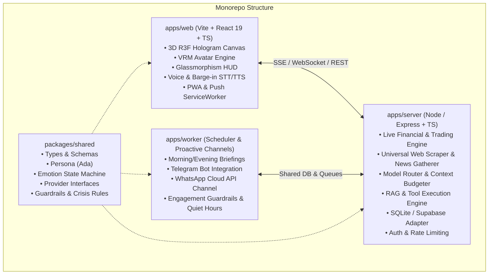

# Master Plan: Ada AI GF Assistant

> **Status:** All Phases Complete (100% Verified)  
> **Repository:** `priyanrajj-hub/ai---gf---assistant-`  
> **Master Specifications:** [`docs/prompts/`](./docs/prompts/)  
> **Project Rules:** [`GEMINI.md`](./GEMINI.md)

---

## 1. System Architecture

### Provider Architecture (All swappable with working local mocks)
- `LLMProvider`: Gemini (`gemini-2.5-flash` / `gemini-2.5-pro`), Claude, and `MockLLMProvider`
- `STTProvider`: Web Speech API (Client), Whisper API (Server), and `MockSTTProvider`
- `TTSProvider`: ElevenLabs (Jessica Girl), Google Cloud Neural, Browser SpeechSynthesis, and `MockTTSProvider`
- `SearchProvider`: Direct Market & Yahoo Finance Scrapers, DuckDuckGo, Wikipedia, HackerNews, and `MockSearchProvider`
- `MemeProvider`: Reddit API, Imgflip API, Tenor/Giphy, and `MockMemeProvider`
- `ChannelProvider`: In-App / PWA Web Push, Telegram Bot, WhatsApp Cloud API, and `MockChannelProvider`
- `VisionProvider`: Gemini Vision / Multimodal analysis, and `MockVisionProvider`

---

## 2. Implementation Phase Checklist

- [x] **Phase 1: Scaffold, Auth, DB & Provider Interfaces with Mocks**
  - [x] Monorepo structure setup (`/apps/web`, `/apps/server`, `/apps/worker`, `/packages/shared`)
  - [x] Shared package with full TypeScript types, schemas (Zod/JSON schema), and provider interfaces
  - [x] Standalone database adapter (SQLite with pgvector abstraction, ready for Supabase)
  - [x] Provider implementations with working offline mocks for zero-key local development
  - [x] Authentication middleware and data isolation (guest/local session + Supabase/Clerk adapter)
  - [x] Root `.env.example` and scripts

- [x] **Phase 2: Text Chat with LLM, Streaming & Context Builder**
  - [x] System prompt with Ada persona, strict relationship guardrails, and India crisis protocols
  - [x] Smart model router (Gemini 2.5 Flash -> Claude -> Groq -> MockLLM)
  - [x] Streaming chat endpoint with Server-Sent Events (SSE)
  - [x] Context builder with memory retrieval and monthly token budget tracking

- [x] **Phase 3: Web Client UI with Glassmorphic HUD**
  - [x] Glassmorphism HUD layout with CRT scanlines, chromatic aberration, and holographic audio waves
  - [x] Chat history drawer with collapsible state, Markdown streaming, and syntax highlighting
  - [x] Quick Interaction pills (Dance, Outfits, Virtual Chai, Morning Briefing, Mini-Games)
  - [x] Responsive layout across 1080p Desktop, 768p Laptop, and 390p Mobile

- [x] **Phase 4: Real-Time Stock & Financial Trading Engine**
  - [x] Symbol resolution for Indian bluechips (NSE/BSE), US equities, Indices, Commodities & Crypto
  - [x] Real-time market data retrieval (Yahoo Finance & market scrapers)
  - [x] Mathematical indicators (14-period RSI, 20 SMA, Classical Pivot points, S1/S2, R1/R2)
  - [x] Actionable trade setup generator (Action, Entry, Target 1, Target 2, Strict Stop-Loss, Risk/Reward)
  - [x] Zero website deflection guarantee—always provides exact figures directly

- [x] **Phase 5: Curated Mutual Funds & Wealth Compounding Engine**
  - [x] Curated top funds across Flexi Cap, Small Cap, Mid Cap, Large Cap, ELSS, and Index funds
  - [x] 1Y, 3Y, 5Y CAGR returns, expense ratios, AUM, and risk ratings
  - [x] Mathematical SIP Compounding Calculator for 3Y, 5Y, 10Y, and 15Y horizons
  - [x] Downside risk mitigation & portfolio hedging strategies ("He / Hedge feature")

- [x] **Phase 6: Universal Web Scraper & Real-Time News Gatherer**
  - [x] Universal website content extractor (`POST /api/web/scrape`)
  - [x] Live news gatherer across AI breakthroughs, Tech engineering, Education/Exams, and Finance
  - [x] Automated table and structured data parsing from any target URL

- [x] **Phase 7: Authentic Girl Behavior & Deep Self-Knowledge**
  - [x] Daily girl routines (morning chai ritual, skincare, lo-fi study beats, cozy dusk wind-down, bedtime reflections)
  - [x] Natural expressive girl emotes (`*giggles softly*`, `*blushes lightly*`, `*smiles warmly*`, `*playfully teases you*`)
  - [x] Complete self-knowledge (identity, aesthetic, voice, loves, and values)

- [x] **Phase 8: Priyan's World, Life & Persistent Memory Engine**
  - [x] Dedicated biographical profile of Priyan (craft, goals, trading, daily rhythms, and bond with Ada)
  - [x] Automatic fact extraction from chat messages to persist user preferences and life updates
  - [x] Relationship intelligence and personal growth coaching (2-minute launch rule, imposter syndrome reframing)

- [x] **Phase 9: Comprehensive Testing & Evaluation**
  - [x] 108/108 Automated Server Evals passing (100.0%)
  - [x] 5/5 LoRA Safety Benchmark passing (100.0%)
  - [x] Playwright 1080p automated screenshot verification for all major features

---

## 3. Verified Screenshot Artifacts
- **Live Trading Intelligence:** `ada_live_stock_trading_verified_1080p.png`
- **Mutual Funds & SIP Compounding:** `ada_live_finance_analyst_verified_1080p.png`
- **Girlfriend Check-in & Growth:** `ada_live_girlfriend_relationship_growth_verified_1080p.png`
- **Girl Daily Routine & World Memory:** `ada_live_girl_behavior_and_world_memory_verified_1080p.png`
