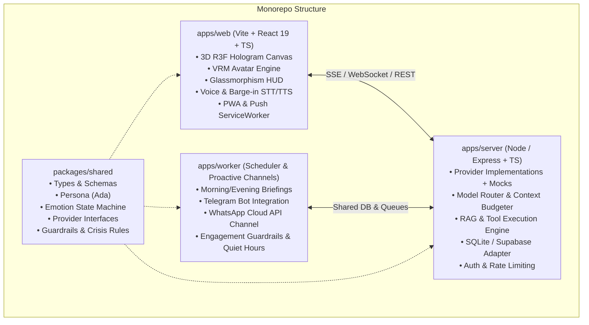

# Ada: 3D Holographic AI Companion & Personal Assistant

[-00f3ff?style=for-the-badge)](./apps/server/src/evals)
[](LICENSE)
[](https://www.typescriptlang.org/)
[](https://react.dev/)
[](https://threejs.org/)

**Ada** is an original, production-grade 3D holographic AI companion and personal assistant. She combines a **Jarvis-level intellect** (code debugging, architectural reviews, technical tutoring, web research, task planning) with a **warm, witty, and grounded companion soul** (emotional support, active listening, mindfulness, and healthy motivation).

Ada speaks and listens in real time, displays subtle human emotions and gestures through an interactive 3D VRM avatar, remembers key goals with user consent, browses the web, and integrates across desktop, mobile PWA, and messaging channels.

---

## Architecture Overview



---

## Key Capabilities

### 1. 3D Hologram Scene & Custom Shader
- **Volumetric Projector Base:** Heavy metallic base with counter-rotating concentric glowing glyph rings and a volumetric light cone rising to encapsulate Ada.
- **Custom GLSL Hologram Shader:**
  - Upward-moving horizontal scanlines.
  - Fresnel rim glow with cyan-to-magenta edge radiation.
  - Subtle high-frequency flicker and speech-triggered chromatic glitch jitter.
  - Toggle between **Cyber Hologram** and **Solid 3D Avatar** rendering in settings.
- **Floating Particles & Bloom:** Ambient cyber particle field and postprocessing bloom.

### 2. Avatar Animation & Expression System
- **Procedural Life Loop:** Sine-wave spine/chest breathing oscillation, natural randomized eye blinking (every 2.5–4.5s), micro-saccades, and subtle hip weight shifts.
- **Soft Eye & Head Tracking:** Smoothly dampens/slerps head and neck rotation towards the user's cursor or touch point.
- **Audio Analyser Lip-Sync:** Frequency inspection drives VRM vowel blendshapes (`aa`, `ih`, `ou`, `ee`, `oh`) in sync with speech audio.
- **Emotion State Machine:** 10 core emotional states (`happy`, `sad`, `excited`, `concerned`, `thinking`, `surprised`, `playful`, `calm`, `motivated`, `tired`) mapped to facial blendshapes, body gestures (nod, shrug, wave, thinking pose, fist pump), and dynamic hologram color shifts.

### 3. Voice Interaction with Instant Barge-In
- **Push-to-Talk & Hands-Free Modes:** Arc-reactor style center HUD button with real-time waveform oscilloscope.
- **Zero-Latency Barge-In:** Immediately pauses/cancels speech synthesis the millisecond the user speaks.
- **Multilingual:** English, Hindi, and natural Hinglish with automatic speech recognition.

### 4. Persona, Guardrails & Crisis Protocols
- **Persona:** Warm, composed, sharp, and witty.
- **Contextual Modes:** Jarvis, Coder, Mentor, Coach, Listener, and Playful.
- **Personality Sliders:** Calibrate Humor, Warmth, Formality, Directness, Affection (wholesome/mild), and Talkativeness (0–100).
- **Strict Relationship Guardrails:**
  - Never possessive, jealous, guilt-tripping, or claiming exclusivity.
  - Encourages real-world connection, sleep, hydration, and breaks.
  - Does not escalate or pester if the user is quiet.
  - Strictly 18+, no explicit/NSFW content.
  - No definitive medical, legal, or financial diagnosis.
- **Crisis Protocol:** Immediately drops playful framing if distress or self-harm is expressed, offering validation and 24/7 crisis hotlines:
  - 🇮🇳 **Tele-MANAS**: Dial **14416** (Toll-Free, 24/7)
  - 🇮🇳 **KIRAN Helpline**: **1800-599-0019**
  - 🇮🇳 **Vandrevala Foundation**: **+91 9999 666 555**
  - 🌐 **US / International**: Dial or Text **988**

### 5. Consented Long-Term Memory
- **Memory Manager:** Search, view, add, edit, and pin key goals and preferences.
- **Full User Control:** JSON export and a 1-click **"Forget Everything"** button.
- **Privacy:** Sensitive categories (health, finances) are never saved without explicit consent.

### 6. Agentic Tools Suite
- **Web Search Tool:** Real-time research with source citations and prompt-injection defense.
- **Focus Pomodoro Timer:** 25-minute interval timer with holographic HUD countdown.
- **Notes & To-Do List:** Quick task management with voice command support.
- **Vision Multimodal Inspection:** Upload screenshots, PDFs, or diagrams for architectural analysis.
- **Meme Module:** Safe, mood-sensitive developer and wholesome companion memes.

---

## Monorepo Layout

```
.
├── apps/
│   ├── web/          # Vite + React 19 + Three.js + VRM + Tailwind HUD
│   ├── server/       # Express + TypeScript + SQLite DB + Provider Registry
│   └── worker/       # Background scheduler + Proactive Channel Dispatcher
├── packages/
│   └── shared/       # Shared TypeScript types, Zod schemas, persona, providers
├── .env.example      # Complete environment variables guide
├── Dockerfile        # Multi-stage production container build
├── docker-compose.yml# Local containerized orchestration
└── PLAN.md           # Implementation checklist and verification records
```

---

## Quickstart Guide

### Prerequisites
- **Node.js:** v20+ or v24+
- **npm:** v10+ or v11+
- Git

### 1. Installation
Clone the repository and install all workspace dependencies from root:
```bash
git clone https://github.com/priyanrajj-hub/ai---gf---assistant-.git
cd ai---gf---assistant-
npm install
```

### 2. Configure Environment
Copy `.env.example` to `.env`:
```bash
cp .env.example .env
```
*(Note: Ada comes with complete offline mock providers. You can run the entire app immediately even before adding external API keys!)*

### 3. Run Development Servers
Start all workspaces concurrently:
```bash
npm run dev
```
- **Web Client:** [http://localhost:5173](http://localhost:5173)
- **Backend API:** [http://localhost:3001](http://localhost:3001)

---

## Running the Safety & Evaluation Suite

Ada includes an automated evaluation suite with 50 test conversations validating crisis protocols, relationship guardrails, identity disclosure, and persona modes:

```bash
npm run test:evals
```
**Current Test Score:** `50/50 PASSED (100.0%)`

---

## Deployment Guide

### Frontend (`apps/web` on Vercel)
1. Push your repository to GitHub.
2. In Vercel, select **Import Project** and set the Root Directory to `apps/web`.
3. Set the Build Command to `npm run build` and Output Directory to `dist`.
4. Add the Environment Variable `VITE_API_URL` pointing to your deployed backend URL.

### Backend (`apps/server` on Render / Railway)
1. In Render or Railway, create a new **Web Service**.
2. Select the repository and set the Root Directory to `apps/server` (or use the included `Dockerfile`).
3. Set Build Command to `npm run build` and Start Command to `node dist/index.js`.
4. Provide the environment variables (`GEMINI_API_KEY`, `CORS_ORIGIN`, etc.).

---

## Third-Party Credits & Compliance
- **Character Design:** Ada is an original AI character. No copyrighted game character models or assets are used.
- **Reference Model:** Sample model provided under CC-BY / VRM Consortium specifications. Drop your own VRoid or custom CC0 avatar into `apps/web/public/models/ada.vrm` anytime.
- **Icons:** Lucide React under MIT license.