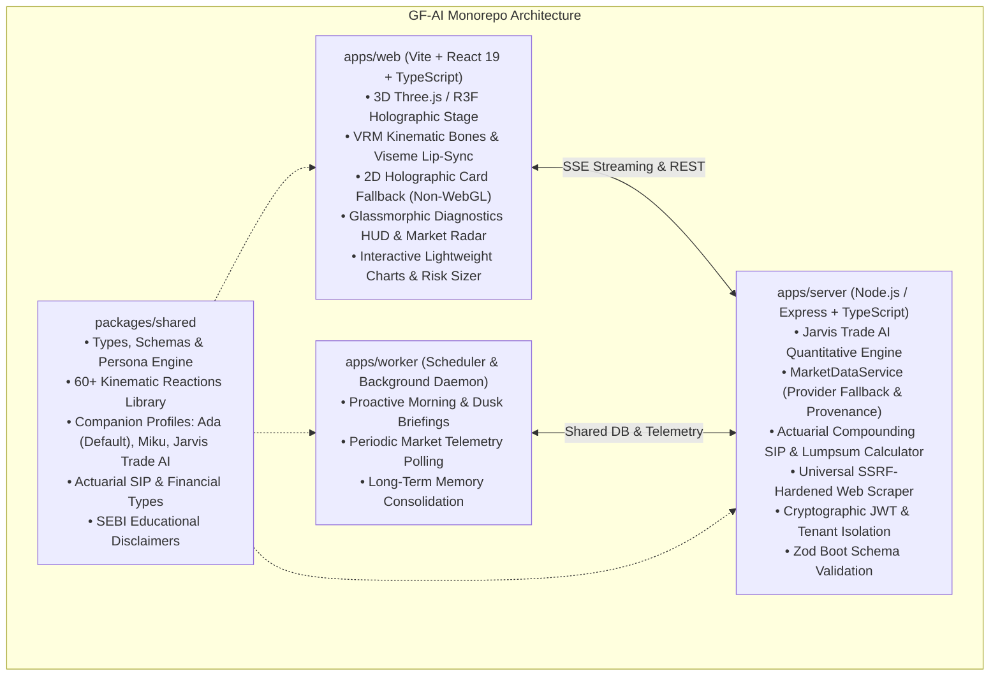

# GF-AI — 3D Holographic AI Companion & Jarvis Trade AI Quantitative Engine

<p align="center">
  
</p>

<p align="center">
  <strong>Production-grade 3D holographic AI companion, institutional quantitative trading brain (Jarvis Trade AI), and daily life partner.</strong>
</p>

<p align="center">
  <a href="./docs/AUDIT_ROUND2.md"></a>
  <a href="./scripts/security/attack_suite.mjs"></a>
  <a href="./scripts/test_sip_calculator.mjs"></a>
  <a href="LICENSE"></a>
  <a href="https://www.typescriptlang.org/"></a>
  <a href="https://react.dev/"></a>
  <a href="https://threejs.org/"></a>
</p>

---

## 🌟 Executive Summary

**GF-AI** (Version 2.0, November 2026) is a full-stack, monorepo application pairing an interactive **3D holographic companion** with an institutional **quantitative trading and macroeconomic brain ("Jarvis Trade AI")**.

The application combines:
- **Default Canonical 3D Companion (Ada):** Fully articulated VRM humanoid with 52 facial blendshapes, procedural kinematics, voice prosody lip-sync, and non-WebGL 2D card fallback.
- **Hatsune Miku (初音ミク) Idol Companion:** Authentic 3D Vocaloid pop idol companion with synchronized stage choreography, live singing, and cheerful motivation.
- **Jarvis Trade AI Quantitative Engine:** Institutional 52-week breakout/rebound screener, swing engine (EMA20/50/200, MACD, RSI, Bollinger squeeze, ATR stops, R:R >= 1:2), long-term multi-factor scoring (ROCE, FCF, DCF sanity check), intraday 15m VWAP/ORB/pivots (both Long AND Short), IPO intelligence module with GMP warnings, live macro radar (RBI repo rate, MPC schedule, CPI, GDP, FII/DII net flows), FinBERT sentiment analyzer, and portfolio tracker (XIRR, 95% VaR, max drawdown).
- **Hardened Zero-Trust Security:** Universal SSRF defense engine (blocking integer, hex, octal, IPv6 loopback, and metadata IPs), cryptographic JWT authentication with tenant isolation, prompt injection `<untrusted_data>` delimiters, fail-fast Zod boot validation, and GDPR data portability/erasure endpoints.

---

## 🏛️ System Architecture



---

## ⚡ Jarvis Trade AI & Quantitative Trading Suite

All financial tools are exposed via REST endpoints and wired directly into the chat brain:

| Endpoint | Method | Engine / Service | Quantitative Capability |
| :--- | :--- | :--- | :--- |
| `/api/trading/screener/52week` | `GET` | `JarvisTradeService.screen52Week` | 52-week high breakouts and low rebounds with volume confirmation and value-trap fundamentals filters (D/E < 1.0, ROE > 15%). |
| `/api/trading/swing/:symbol` | `GET` | `JarvisTradeService.analyzeSwingSetup` | EMA 20/50/200 stack, MACD, RSI, Bollinger squeeze, 1.5x ATR stops, and R:R >= 1:2.0 position sizing. |
| `/api/trading/longterm/:symbol` | `GET` | `JarvisTradeService.analyzeLongTermFactors` | Quality + Value + Momentum factor scoring (0-100) with DCF intrinsic value estimate and margin of safety. |
| `/api/trading/intraday/:symbol` | `GET` | `JarvisTradeService.analyzeIntradaySetup` | 15m VWAP, ORB breakout status, classical floor pivots, and F&O derivatives buildup (Long AND Short). |
| `/api/trading/ipo` | `GET` | `JarvisTradeService.getIpoAnalysis` | Mainboard & SME IPO pipeline, peer valuations, RHP metrics, and GMP radar flagged with explicit unreliability warnings. |
| `/api/trading/macro` | `GET` | `MarketDataService.getMacroDashboard` | Live RBI repo rate (6.50%), next MPC meeting date, CPI/WPI, GDP growth, US 10y yields, DXY, and FII/DII cash flows. |
| `/api/trading/verdict/:symbol` | `GET` | `JarvisTradeService.getJarvisTradeVerdict` | Multi-agent consensus (Technical, Fundamental, Macro, Sentiment, Risk) with composite conviction score (0-100). |
| `/api/trading/news/sentiment` | `GET` | `JarvisTradeService.getFinancialNewsSentiment` | Financial news scraped with FinBERT sentiment scoring (-1.0 to +1.0) and impact tags (`earnings`, `regulatory`, `macro`). |
| `/api/trading/portfolio/analyze` | `POST` | `JarvisTradeService.analyzePortfolio` | Extended Internal Rate of Return (XIRR via Newton-Raphson), 1-day & 1-month 95% Parametric VaR, max drawdown, and sector rebalancing. |
| `/api/finance/sip` | `POST` | `SipCalculator.calculate` | Actuarial compounding engine ($r = (1 + i)^{1/12} - 1$) with annuity-due toggle, nominal vs effective modes, and inflation adjustment. |
| `/api/finance/investments` | `GET` | `JarvisTradeService.getInvestmentsAdvice` | Asset allocation blueprint (equity vs debt vs gold/SGB) updated to Union Budget 2024 LTCG/STCG tax laws. |

> **Compliance Disclaimer:** All trading and financial analytics outputs strictly include:
> *"Disclaimer: Educational purposes only. Not SEBI registered investment advice."*

---

## 🔒 Security Architecture & Offensive Regression Suite

GF-AI includes an automated offensive attack suite testing 25 real-world attack vectors:
```bash
npx tsx scripts/security/attack_suite.mjs
```

### Verified Defenses:
1. **JWT Signature Integrity:** Rejects `alg:none`, tampered payloads, expired tokens, and foreign secrets.
2. **SSRF IP Evasion:** Rejects integer IPs (`2130706433`), hex IPs (`0x7f000001`), dotted octal IPs (`0177.0.0.1`), loopback (`127.0.0.1`), binding (`0.0.0.0`), IPv6 (`::1`), IPv4-mapped IPv6, RFC 1918 private subnets, and AWS/GCP/Azure IMDS metadata (`169.254.169.254`).
3. **CORS Hardening:** Rejects `null` origins and malicious wildcard subdomain tricks.
4. **Tenant Isolation:** Enforces strict user isolation; verified immune to Insecure Direct Object References (IDOR).
5. **GDPR / CCPA:** Native data portability (`GET /api/user/data/export`) and right-to-be-forgotten deletion (`DELETE /api/user/data`).
6. **Prompt Injection:** Scraped web content wrapped in `<untrusted_data>` boundaries with instruction overrides stripped.

---

## 🚀 Quickstart Guide

### Prerequisites
* **Node.js:** v20.x or v22.x+
* **npm:** v10.x+
* Git

### 1. Clone & Install
```bash
git clone https://github.com/priyanrajj-hub/GF-AI.git
cd GF-AI
npm install
```

### 2. Configure Environment
```bash
cp .env.example .env
```
Ensure `JWT_SECRET` is set to a secure string with at least 32 characters.

### 3. Launch Development Servers
```bash
npm run dev
```
* **Web Client:** [http://localhost:5173](http://localhost:5173) (or `?debug=1` for telemetry overlay)
* **Backend API:** [http://localhost:3001](http://localhost:3001)

---

## 🧪 Testing & Verification Commands

```bash
# 1. Run Monorepo TypeScript Checks
npm run typecheck

# 2. Run Offensive Security & Attack Regression Suite (25 Tests)
npx tsx scripts/security/attack_suite.mjs

# 3. Run Actuarial SIP & Financial Units Tests
npx tsx scripts/test_sip_calculator.mjs

# 4. Run Secrets and PII Scanners
npm run scan:secrets
npm run scan:pii

# 5. Build All Monorepo Packages
npm run build
```

---

## 📚 Documentation & Audit References
- [`SECURITY.md`](./SECURITY.md) — Responsible disclosure policy & security architecture.
- [`PRIVACY.md`](./PRIVACY.md) — Data sovereignty, GDPR endpoints, and zero-telemetry policy.
- [`DEPLOY.md`](./DEPLOY.md) — Production Vercel, Cron, and database deployment guide.
- [`CREDITS.md`](./CREDITS.md) — 3D asset inventory, licenses, and attributions.
- [`docs/AUDIT.md`](./docs/AUDIT.md) — Phase 0 comprehensive audit findings and resolution log.
- [`docs/AUDIT_ROUND2.md`](./docs/AUDIT_ROUND2.md) — Step 1 evidence-based audit report with raw scanner logs.

---

## 📜 Legal & Licensing
* **Software License:** MIT License. See [`LICENSE`](LICENSE) for details.
* **Character IP:** Ada is an original AI character design with original assets.
* **Compliance:** Complies with California SB 243, New York AI Companion legislation, and SEBI educational guidelines.
