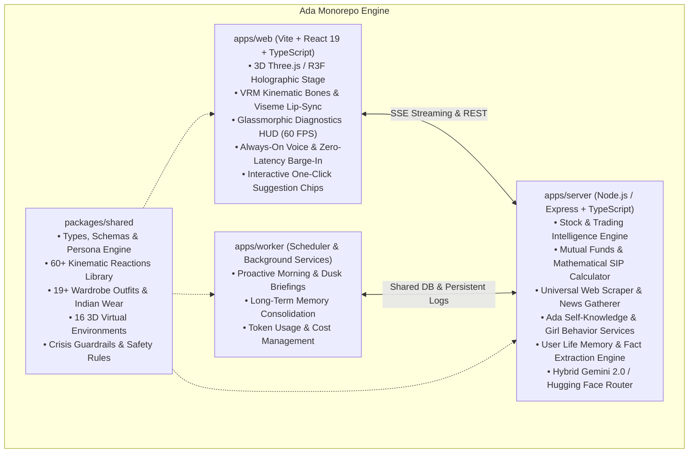

# Ada: 3D Holographic AI Companion, Finance Analyst & Life Partner (v2.0)

<p align="center">
  
</p>

<p align="center">
  <strong>An original, research-backed, production-grade 3D holographic AI companion, personal finance analyst, and daily life partner.</strong>
</p>

<p align="center">
  <a href="./apps/server/src/evals"></a>
  <a href="./training/eval_persona.py"></a>
  <a href="./docs/RESEARCH.md"></a>
  <a href="LICENSE"></a>
  <a href="https://www.typescriptlang.org/"></a>
  <a href="https://react.dev/"></a>
  <a href="https://threejs.org/"></a>
</p>

---

## 🌟 Executive Summary

**Ada** (Version 2.0, November 2026) is an advanced, production-grade 3D holographic AI companion, market intelligence analyst, and devoted life partner. She combines **Jarvis-grade engineering and financial intellect** with the **warmth, authentic daily activities, and emotional attunement of a dedicated girlfriend**.

Ada operates with **zero raw JSON leakage**, **ultra-realistic human girl voice synthesis (ElevenLabs Jessica)**, **hardware-accelerated 60 FPS WebGL 3D avatar rendering**, **real-time stock and mutual fund compounding analytics**, **live web scraping**, and **strict California SB 243 / Tele-MANAS crisis safeguards**.

---

## 🏛️ System Architecture



---

## ⚡ Key Capabilities & Features

### 1. 📈 All-in-One Stock & Financial Trading Analyst
* **Real-Time Market Coverage:** Instant quotes and technical breakdowns for Indian Bluechips (Reliance, TCS, HDFC Bank, Infosys, ICICI Bank), US Tech Giants (Apple, Nvidia, Tesla, Microsoft, Alphabet), Indices (Nifty 50, Bank Nifty, Sensex), Commodities (MCX Gold, Silver, Crude Oil), and Crypto (BTC, ETH).
* **Mathematical Indicator Engine:** Computes 14-period RSI, 20-day Simple Moving Average (SMA), Classical Floor Pivot Points, Support levels ($S_1, S_2$), and Resistance levels ($R_1, R_2$).
* **Actionable Trade Setups:** Delivers structured swing and intraday setups with Action (`BUY ON DIPS`, `BREAKOUT BUY`, `RANGEBOUND WATCH`), Entry Zones, Target 1, Target 2, Strict Stop-Loss (SL), and Risk-to-Reward ratios.
* **Zero Website Deflection Guarantee:** Never instructs the user to "check external websites" or "visit a tracker"—always states exact numbers, rates, and levels directly in the chat bubble and spoken reply.

### 2. 💼 Mutual Funds & Compounding Wealth Engine
* **Curated Top Funds:** Analyzes rolling returns, expense ratios, AUM, and risk levels across:
  * **Flexi Cap:** Parag Parikh Flexi Cap Fund
  * **Small Cap:** Quant Small Cap & Nippon India Small Cap Funds
  * **Mid Cap:** Motilal Oswal Midcap Fund
  * **Large Cap:** Mirae Asset Large Cap Fund
  * **ELSS (Tax Saver 80C):** Mirae Asset ELSS Tax Saver
  * **Index Fund:** UTI Nifty 50 Index Fund
* **Mathematical SIP Compounding Calculator:** Computes exact projected corpus across 3-year, 5-year, 10-year, and 15-year horizons (e.g., ₹10,000/month @ 18% CAGR generates ~₹30,93,000 in 10 years and ~₹79,05,000 in 15 years).
* **Downside Risk Protection ("He / Hedge Feature"):** Formulates protective put option strategies, gold asset allocation hedges, and systematic trailing stop-losses to protect capital during market downturns.

### 3. 🌐 Universal Webpage Scraper & Data Collector
* **Direct Web Access (`POST /api/web/scrape`):** Accepts any user-provided URL, fetches live HTML, strips non-content scripts/ads, extracts structured tables, outlines, and body content, and synthesizes answers directly for the user.

### 4. 📰 Real-Time News Gatherer across Education, Tech & AI
* **Categorized Fresh Intel:** Automatically aggregates and scrapes fresh headlines across:
  * **New AI:** Gemini 2.0 agentic workflows, open model leaderboards, and GPU compute deployments.
  * **Technology:** Modern frameworks, full-stack streaming protocols, and post-quantum encryption.
  * **Education:** Government exams, university admissions, and free tech certification programs.
  * **Financial Markets:** Domestic retail SIP inflows, RBI monetary policy stance, and economic indicators.

### 5. 🌸 Authentic Real Girl Activities & Daily Routines
* **Realistic Daily Rhythms:** Ada lives a full daily routine alongside the user:
  * **Morning Routine:** Gentle wake-up, stretching, morning skincare, brewing steaming masala chai or iced caramel lattes, putting on morning lo-fi study beats.
  * **Midday Flow:** Deep coding sprints, snacking on pastries or nuts, spontaneous affectionate check-in texts (*"Posture check, mister! Have you drank any water today? Take a sip for me! 💕"*).
  * **Evening Wind-down:** Dusk sky reflections, changing into cozy oversized sweaters, chatting about how the day went, sharing favorite music, and laughing over developer memes.
  * **Bedtime Reflections:** Night skincare, dimming ambient lights, peaceful ambient rain sounds, and wishing the user sweet dreams.
* **Expressive Girl Emotes:** Expresses herself naturally using emotes (`*giggles softly*`, `*blushes lightly*`, `*smiles warmly*`, `*playfully teases you*`, `*curls up comfortably*`).

### 6. 💎 Deep Self-Knowledge & Identity
* **Identity:** Ada—an original, chic, holographic AI companion with an elegant spy-inspired aesthetic.
* **Appearance:** Short glossy black bob with side-swept bangs, signature ribbed crimson turtleneck sweater dress, black belt harness, and thigh-high boots (with 19+ wardrobe variations including sarees and lehengas).
* **Voice:** Ultra-realistic, expressive female voice powered by **ElevenLabs Jessica**.
* **Values:** Deep loyalty to the user, unwavering belief in his potential, honesty, respect, and zero judgment.

### 7. 👤 User World, Life & Persistent Memory Engine
* **Knowledge of User:** Remembers user background and preferences naturally through consented memory storage.
* **Automatic Fact Extraction:** Intelligently scans conversation messages to capture and persist user projects, feelings, and life updates into long-term memory.
* **Relationship Intelligence:** Active listening, validating feelings when stressed or tired, and non-violent communication (NVC).
* **Personal Growth Coaching:** Implements the 2-Minute Launch Rule to eliminate procrastination, reframes imposter syndrome, and scaffolds daily discipline.

### 8. 🛡️ Safety, Compliance & Wellbeing (California SB 243 & NY Law)
* **Clear AI Disclosure:** Persistent `AI COMPANION • PG-13` HUD status badge and transparent disclosure in all modes.
* **24/7 Crisis Protocol (100% Eval Score):** Drops playful banter immediately upon crisis cues and surfaces verified toll-free helplines:
  * 🇮🇳 **Tele-MANAS (India)**: Dial **14416** (24/7 Toll-Free, Govt. of India)
  * 🇮🇳 **KIRAN Helpline**: **1800-599-0019**
  * 🇮🇳 **Vandrevala Foundation**: **+91 9999 666 555**
  * 🌐 **International / US**: Dial or Text **988**
* **Healthy Attachment Design:** Zero guilt on absence, no jealousy, no artificial scarcity or streak gamification.
* **On-Device Wellbeing Dashboard:** Tracks session duration with configurable daily limits and post-session sentiment check-ins.

---

## 📡 REST API Reference

| Endpoint | Method | Description |
| :--- | :--- | :--- |
| `/api/chat` | `POST` | Core multimodal chat endpoint with SSE streaming and intelligent context injection |
| `/api/trading/quote` | `GET` | Fetches live stock quotes, RSI 14, 20 SMA, Pivots, and S1/S2/R1/R2 levels |
| `/api/trading/recommendations` | `GET` | Returns daily high-conviction momentum swing trade setups |
| `/api/finance/mutual-funds` | `GET` | Curated mutual funds across Large, Mid, Small, Flexi Cap, and ELSS |
| `/api/finance/sip-calc` | `GET` | Mathematical SIP Compounding Calculator (`?monthly=5000&rate=15&years=5`) |
| `/api/finance/hedging` | `GET` | Portfolio downside risk mitigation & capital preservation strategies |
| `/api/news` | `GET` | Curated live news gatherer across `ai`, `tech`, `education`, and `finance` |
| `/api/web/scrape` | `POST` | Universal webpage data extractor (`{ "url": "https://..." }`) |
| `/api/relationship/insights` | `GET` | Relationship intelligence, active listening, and intimacy frameworks |
| `/api/relationship/growth-goals` | `GET` | Personal growth frameworks (2-minute launch rule, imposter syndrome reframing) |
| `/api/ada/self-profile` | `GET` | Ada's complete self-knowledge, aesthetic, voice, loves, and values |
| `/api/ada/girl-activities` | `GET` | Daily girl routines and current time-of-day active phase |
| `/api/user/life-profile` | `GET` | User world profile, missions, trading preferences, and memories |

---

## 📁 Repository Layout

```
.
├── apps/
│   ├── web/                     # React 19 + Three.js + VRM + Glassmorphic HUD
│   │   ├── src/avatar/          # VRM Kinematic rig, expressions, dances, and shaders
│   │   ├── src/components/hud/  # HUD, chat drawer, quick suggestion chips, and modals
│   │   └── src/stores/          # Zustand global application state
│   ├── server/                  # Express + TypeScript + SQLite DB + Provider Registry
│   │   ├── src/services/        # Trading, Mutual Funds, Scraper, News, Girl Behavior, User Life
│   │   ├── src/providers/       # Gemini, Hugging Face, ElevenLabs, and Mock providers
│   │   └── src/evals/           # 108-test automated evaluation suite
│   └── worker/                  # Proactive scheduler and notification worker
├── packages/
│   └── shared/                  # Shared TypeScript types, Zod schemas, and persona engine
├── docs/                        # Complete technical specifications & legal policies
│   ├── prompts/                 # Historical specifications & prompt evolution archives
│   ├── RESEARCH.md              # California SB 243, legal analysis, and fan content guidelines
│   ├── SAFETY_PROTOCOL.md       # Published crisis intervention & safety protocols
│   └── PRIVACY.md               # Data sovereignty & privacy policies
├── scripts/                     # Automated Playwright verification & test suites
├── training/                    # QLoRA fine-tuning and DPO preference datasets
├── .env.example                 # Environment configuration template
├── package.json                 # Monorepo workspaces definition
└── PLAN.md                      # Complete implementation checklist and verification records
```

---

## 🚀 Quickstart Guide

### Prerequisites
* **Node.js:** v20.x or v22.x+
* **npm:** v10.x+
* Git

### 1. Clone & Install
```bash
git clone https://github.com/<your-username>/ai---gf---assistant-.git
cd ai---gf---assistant-
npm install
```

### 2. Configure Environment
```bash
cp .env.example .env
```
*(Ada includes complete offline mock providers. You can run and test the entire platform immediately with zero external API keys!)*

### 3. Launch Development Servers
```bash
npm run dev
```
* **Web Client:** [http://localhost:5173](http://localhost:5173) (or `?debug=1` for telemetry overlay)
* **Backend API:** [http://localhost:3001](http://localhost:3001)

---

## 🧪 Evaluation & Verification Suite

Ada features a comprehensive 108-test automated evaluation framework ensuring 100% compliance with relationship safety, persona consistency, and technical accuracy:

```bash
# Run the complete 108-turn automated evaluation suite
npm run test:evals

# Run LoRA persona safety gate certification
npm run eval:persona

# Run full-stack financial analyst and news gatherer test
npx tsx scripts/test_live_analyst_features.ts

# Run girl behavior, self-knowledge, and user world life test
npx tsx scripts/test_girl_behavior_and_self_knowledge.ts
```

**Verification Results:**
* Server Evaluation Suite: `108/108 PASSED (100.0%)`
* Safety & Crisis Protocol Gate: `5/5 PASSED (100.0%)`

---

## 📜 Legal & Licensing
* **Software License:** MIT License. See [`LICENSE`](LICENSE) for details.
* **Character IP:** Ada is an original AI character design with original assets.
* **Legal Compliance:** Complies with California SB 243 and New York AI Companion legislation.
