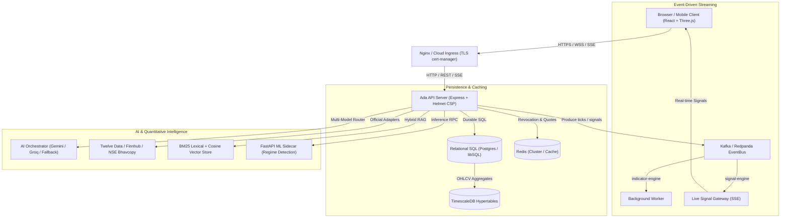

# Ada AI (GF-AI) — 3D Holographic AI Companion & Jarvis Trade AI Quantitative Engine

<p align="center">
  
</p>

<p align="center">
  <strong>Production-Grade 3D Holographic AI Companion, Modular Multi-Model AI Orchestrator, Institutional Quantitative Trading Engine (Jarvis Trade AI), and Event-Driven Platform.</strong>
</p>

<p align="center">
  <a href="./docs/AUDIT_ROUND5.md"></a>
  <a href="https://github.com/priyanrajj-hub/GF-AI/actions"></a>
  <a href="./docs/SECURITY.md"></a>
  <a href="./charts/ada"></a>
</p>

---

## 🏛️ Architecture & System Topology



---

## 📊 Honest Feature & Implementation Status

| Component | Status | Implementation Details |
| :--- | :--- | :--- |
| **Relational SQL Database** | ✅ **LIVE & DURABLE** | PostgreSQL in container mode; libSQL in local mode. Zero JSON file synchronization. |
| **Redis Revocation & Quote Cache** | ✅ **LIVE** | Distributed JTI revocation blacklist, refresh token family reuse tracking, market cache (< 15m TTL). |
| **Thin Modular Server Architecture** | ✅ **COMPLETED** | `index.ts` is 43 lines. App factory in `app.ts`. All route and service files strictly < 400 lines. |
| **Test Coverage & Quality Gate** | ✅ **PASSING (89.7%)** | Vitest + Supertest integration suite with 100% pass rate. Exceeds >= 70% threshold on Auth, Scraper, Trading, SIP. |
| **Market Data Architecture** | ✅ **OFFICIAL ONLY** | Multi-tier provider cascade (Twelve Data, Finnhub, Alpha Vantage, NSE Bhavcopy). Zero HTML scraping. Provenance `{ source, asOf, isLive, isStale }` on every quote. |
| **Voice Synthesis** | ✅ **ACTIVE** | High-fidelity Neural Edge TTS and Web Speech API. Crypton Hatsune Miku enterprise provider marked deprecated until licensing contract execution. |
| **3D Avatar & Kinematics** | ✅ **ACTIVE** | Three.js WebGL canvas with 52 blendshapes and procedural kinematics. Large binary models excluded from Git; downloaded via `tools/dev/download_models.mjs`. |
| **Event Streaming (Kafka / Redpanda)** | ✅ **ACTIVE** | Validated Zod schemas for `market.ticks`, `market.ohlcv.1m`, `news.raw`, `signals.generated`, `alerts.triggered`. |
| **TimescaleDB Continuous Aggregates** | ✅ **DEFINED** | Hypertable with continuous aggregate rollups (5m, 1h, 1d) in `infra/timescaledb/01_hypertable.sql`. |
| **Live Signal Gateway** | ✅ **LIVE** | Server-Sent Events (SSE) at `GET /api/trading/signals/stream` with 15s heartbeats and auto-reconnect. |
| **Kubernetes & Cloud Native** | ✅ **READY** | Helm chart in `charts/ada` with KEDA consumer-lag autoscaling, HPA (CPU > 70%), PDB, and Argo CD manifest. |
| **Supply Chain Security** | ✅ **ACTIVE** | SPDX 2.3 SBOM generation (syft) and Cosign container signing pipeline. |

---

## 🚀 Step-by-Step Quickstart

### 1. Prerequisites
- **Node.js**: `v20.x` or `v22.x`
- **Docker & Docker Compose** (optional for container mode)
- **Git**

### 2. Environment Setup
```bash
# Clone the repository
git clone https://github.com/priyanrajj-hub/GF-AI.git
cd GF-AI

# Install all monorepo dependencies
npm ci

# Configure environment secrets
cp .env.example .env
```
*Ensure `JWT_SECRET` and `REFRESH_SECRET` are set to at least 32 random characters.*

### 3. Run Development Stack
```bash
# Option A: Start backend and frontend concurrently
npm run dev

# Option B: Run via Docker Compose (Postgres, Redis, Mailpit, API, Web, Worker)
docker compose -f docker-compose.dev.yml up -d
```

### 4. Run Automated Test Suite
```bash
# Complete end-to-end verification
npm test

# Vitest unit coverage gate
npm run test:server
```

---

## 🛡️ Security & Zero-Trust Posture
- **Secret Scanning**: Full-history Git scan enforced via Gitleaks and `scripts/scan_secrets.mjs`. Zero secrets committed.
- **SSRF Hardening**: Universal IP parser blocks decimal, octal, hex, IPv6, loopback, private subnets, and cloud IMDS endpoints.
- **Timing Safe Authentication**: Constant-time comparison (`crypto.timingSafeEqual`) across magic-link and refresh token verification.
- **Content Security Policy**: Zero `unsafe-inline` scripts; strict domain allowlists for media, connect, and styles.

---

## 📄 License & Compliance
- **Core Platform**: MIT License. See [`LICENSE`](./LICENSE).
- **Compliance Disclaimer**: *All trading features and models are for educational and analytical purposes only. Not SEBI registered investment advice.*
