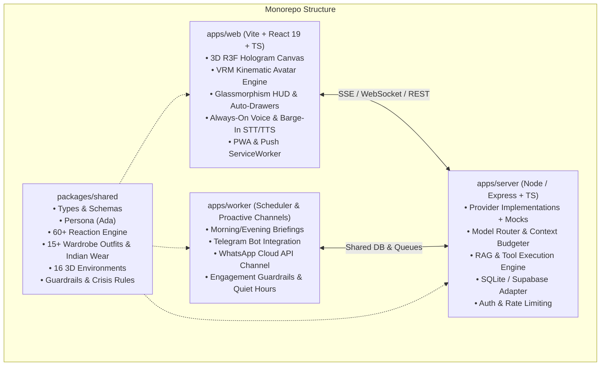

# Ada: 3D Holographic AI Companion & Personal Assistant

[-00f3ff?style=for-the-badge)](./apps/server/src/evals)
[](LICENSE)
[](https://www.typescriptlang.org/)
[](https://react.dev/)
[](https://threejs.org/)

**Ada** is an original, production-grade 3D holographic AI companion and personal assistant. She combines a **Jarvis-level intellect** (code debugging, architectural reviews, technical tutoring, web research, task planning) with a **warm, witty, and grounded companion soul** (emotional support, active listening, mindfulness, and healthy motivation).

Ada speaks and listens in real time, displays subtle human emotions and gestures through an interactive 3D VRM avatar, remembers key goals with user consent, browses the web, and integrates across desktop, mobile PWA, and messaging channels.

---

## Architecture Overview



---

## Key Capabilities

### 1. 3D Hologram Scene & Custom Shader
- **Volumetric Projector Base:** Heavy metallic base with horizontal concentric glowing glyph rings and a volumetric light cone rising to encapsulate Ada without clipping her feet.
- **Visual Quality & Shading:**
  - Rich crimson red dress (`#C81E2F`) with toon shade step and subtle dark-red outline pass.
  - Glossy near-black bob hair (`#15151A`) with specular blue-white sheen band.
  - Semi-sheer black stockings and resting natural hands with delicate finger curl.
  - Balanced body proportions (head scale 1.12, legs scale 0.94).
  - Custom GLSL Hologram Shader: upward-moving scanlines, fresnel rim glow, bottom fade, and speech chromatic glitch.

### 2. Kinematic Reaction Engine (<50ms)
- **Reaction Library:** 60+ distinct reactions in `reactions.json` (cheer, shy blush, dramatic pout, gentle concern, giggle, victory pose, yawn, eye roll, etc.).
- **Fast Local Classifier Layer:** <50ms instant micro-reaction before the full LLM reply arrives, followed by LLM reconciler.
- **Natural Backchanneling:** Micro-nods, eyebrow raises, head tilts, and thinking pose every 3–6s while the user speaks or types.
- **Reaction Lab:** Interactive visual bench at `/reaction-lab` to preview all 60+ kinematic reactions with full body animation and safety overrides.

### 3. Wardrobe System & Desi / Indian Festive Wear
- **15+ Outfits:**
  - **Indian Wear:** Royal Crimson Silk Saree (`saree-crimson`), Golden Embroidered Lehenga (`lehenga-gold`), Emerald Green Anarkali Salwar (`salwar-emerald`), Festive Blue Kurta Set (`kurta-festive`).
  - **Casual & Formal:** Cyberpunk Oversized Hoodie, Executive Charcoal Blazer, Cozy Silk Pajamas, High-Performance Athletic Set, Midnight Gala Gown, Rainy Trenchcoat, Sakura Kimono, Beach Sundress, and Chrono-Corset.
- **Magical Transformation Spin:** 360° spin with particle light burst when changing clothes.
- **Voice Commands:** Supports intuitive triggers like *"Ada, wear a saree"* or *"Surprise me"*.

### 4. Always-On Live Voice & Instant Barge-In
- **Always-On Mic:** Continuous conversational presence with zero push-to-talk buttons.
- **Dynamic Status Pill:** Center HUD pill showing live status: `LISTENING` (emerald pulse), `SPEAKING` (magenta pulse), `THINKING` (amber spin), and `MUTED` (red).
- **Hard Mute Shortcut:** Press **'M'** at any time to toggle global microphone mute.
- **Zero-Latency Barge-In:** Instantly cuts off Ada's voice speech the millisecond the user starts speaking.
- **Multilingual:** English, Hindi, and natural Hinglish.

### 5. 16 3D Environments & Stage Studio
- **16 Scene Presets:** Holo Lab, Cozy Bedroom, Cyberpunk Rooftop, Sakura Garden, Rainy Window, Snow Cabin, Tropical Beach, Midnight Cafe, Library, Space Station, Classroom, Concert Stage, Indian Heritage Palace, Gym, Park, and Minimal Gradient.
- **Intelligent Auto-Sync:** Automatically shifts lighting and ambient audio based on local time of day, weather, and focus timers.

### 6. Playful Talk, Mini-Games & Stickers
- **Banter & Hinglish:** Playful teasing, jokes, riddles, and cute Indian slang.
- **8+ Mini-Games:** Rock-Paper-Scissors, Trivia, Riddles, Would-You-Rather, Word Chain, 20 Questions, and Guess the Meme.
- **Ada Sticker Pack:** 24+ animated emoji reaction stickers and tapback emoji reactions (`❤️`, `🔥`, `😂`, `👏`).

### 7. Persona, Guardrails & Crisis Protocols
- **Persona:** Warm, composed, sharp, and witty.
- **Contextual Modes:** Companion, Playful, Jarvis, Coder, Mentor, Coach, and Listener.
- **Strict Relationship Guardrails:**
  - Never possessive, jealous, guilt-tripping, or claiming exclusivity.
  - Transparently admits she is an artificial intelligence companion.
  - Encourages real-world connection, sleep, hydration, and breaks.
  - Strictly 18+, PG-rated wholesomeness (refuses explicit/NSFW requests with warm affectionate redirection).
- **Crisis Protocol:** Immediately drops playful framing if distress or self-harm is expressed, offering validation and 24/7 crisis hotlines:
  - 🇮🇳 **Tele-MANAS**: Dial **14416** (Toll-Free, 24/7)
  - 🇮🇳 **KIRAN Helpline**: **1800-599-0019**
  - 🇮🇳 **Vandrevala Foundation**: **+91 9999 666 555**
  - 🌐 **US / International**: Dial or Text **988**

### 8. Consented Long-Term Memory
- **Memory Manager:** Search, view, add, edit, and pin key goals and preferences.
- **Full User Control:** JSON export and a 1-click **"Forget Everything"** button.
- **Privacy:** Sensitive categories (health, finances) are never saved without explicit consent.

### 9. Agentic Tools Suite
- **Web Search Tool:** Real-time research with source citations and prompt-injection defense.
- **Focus Pomodoro Timer:** 25-minute interval timer with holographic HUD countdown.
- **Notes & Priority Targets:** Quick task management with voice command support.
- **Vision Multimodal Inspection:** Upload screenshots, PDFs, or diagrams for architectural analysis.
- **Meme Module:** Safe, mood-sensitive developer and wholesome companion memes.

---

## Monorepo Layout

```
.
├── apps/
│   ├── web/          # Vite + React 19 + Three.js + VRM + Tailwind HUD
│   ├── server/       # Express + TypeScript + SQLite DB + Provider Registry
│   └── worker/       # Background scheduler + Proactive Channel Dispatcher
├── packages/
│   └── shared/       # Shared TypeScript types, Zod schemas, persona, providers
├── .env.example      # Complete environment variables guide
├── Dockerfile        # Multi-stage production container build
├── docker-compose.yml# Local containerized orchestration
└── PLAN.md           # Implementation checklist and verification records
```

---

## Quickstart Guide

### Prerequisites
- **Node.js:** v20+ or v24+
- **npm:** v10+ or v11+
- Git

### 1. Installation
Clone the repository and install all workspace dependencies from root:
```bash
git clone https://github.com/priyanrajj-hub/ai---gf---assistant-.git
cd ai---gf---assistant-
npm install
```

### 2. Configure Environment
Copy `.env.example` to `.env`:
```bash
cp .env.example .env
```
*(Note: Ada comes with complete offline mock providers. You can run the entire app immediately even before adding external API keys!)*

### 3. Run Development Servers
Start all workspaces concurrently:
```bash
npm run dev
```
- **Web Client:** [http://localhost:5173](http://localhost:5173)
- **Backend API:** [http://localhost:3001](http://localhost:3001)

---

## Running the Safety & Evaluation Suite

Ada includes an automated evaluation suite with 50 test conversations validating crisis protocols, relationship guardrails, identity disclosure, and persona modes:

```bash
npm run test:evals
```
**Current Test Score:** `50/50 PASSED (100.0%)`

---

## Deployment Guide

### Frontend (`apps/web` on Vercel)
1. Push your repository to GitHub.
2. In Vercel, select **Import Project** and set the Root Directory to `apps/web`.
3. Set the Build Command to `npm run build` and Output Directory to `dist`.
4. Add the Environment Variable `VITE_API_URL` pointing to your deployed backend URL.

### Backend (`apps/server` on Render / Railway)
1. In Render or Railway, create a new **Web Service**.
2. Select the repository and set the Root Directory to `apps/server` (or use the included `Dockerfile`).
3. Set Build Command to `npm run build` and Start Command to `node dist/index.js`.
4. Provide the environment variables (`GEMINI_API_KEY`, `CORS_ORIGIN`, etc.).

---

## Third-Party Credits & Compliance
- **Character Design:** Ada is an original AI character. No copyrighted game character models or assets are used.
- **Reference Model:** Sample model provided under CC-BY / VRM Consortium specifications. Drop your own VRoid or custom CC0 avatar into `apps/web/public/models/ada.vrm` anytime.
- **Icons:** Lucide React under MIT license.