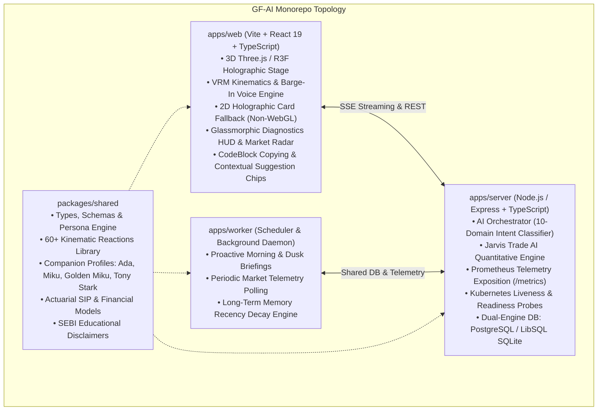

# GF-AI — 3D Holographic AI Companion & Jarvis Trade AI Quantitative Engine

<p align="center">
  
</p>

<p align="center">
  <strong>Production-Grade 3D Holographic AI Companion, Multi-Model AI Orchestrator, Institutional Quantitative Trading Engine (Jarvis Trade AI), and Autonomous Background Scheduler.</strong>
</p>

<p align="center">
  <a href="./docs/ENGINEERING_AUDIT.md"></a>
  <a href="./scripts/security/attack_suite.mjs"></a>
  <a href="./apps/server/src/evals/runEvals.ts"></a>
  <a href="./scripts/test_e2e_flow.mjs"></a>
  <a href="./scripts/test_sip_calculator.mjs"></a>
  <a href="LICENSE"></a>
  <a href="https://www.typescriptlang.org/"></a>
  <a href="https://react.dev/"></a>
  <a href="https://threejs.org/"></a>
</p>

---

## 🌟 Executive Summary

**GF-AI** is an institutional-grade, full-stack monorepo application pairing an interactive **3D holographic companion** with an institutional **quantitative trading and macroeconomic intelligence engine ("Jarvis Trade AI")**.

The application combines:
- **Canonical 3D Companions & Archetypes:**
  - **Ada (Default Canonical):** Humanoid companion with 52 blendshapes, procedural kinematics, real-time lip-sync, and non-WebGL 2D card fallback.
  - **Hatsune Miku (初音ミク):** Authentic 3D Vocaloid pop idol companion with synchronized stage choreography, live singing, and cheerful motivation.
  - **Fortnite Golden Miku (Week 3 Pirate Theme):** Ultra-rare pirate-themed gold idol outfit with ornate treasure chest animations.
  - **Atlas / Tony Stark (Iron Man Mark 85):** High-tech holographic engineering assistant with glowing arc reactor and tactical heads-up display.
- **Jarvis Trade AI Quantitative Engine:** 52-week breakout/rebound screener, swing engine (EMA20/50/200, MACD, RSI, Bollinger squeeze, ATR stops, R:R >= 1:2), long-term factor scoring, intraday 15m VWAP/ORB/pivots (both Long AND Short), IPO pipeline intelligence, live macro radar (RBI repo rate, MPC schedule, CPI, GDP, FII/DII net flows), FinBERT sentiment analyzer, and portfolio tracker (XIRR, 95% VaR, max drawdown).
- **AI Orchestrator with Multi-Model Failover:** 10-domain intent classifier routing queries dynamically across Google Gemini, Groq (Llama 3 70B), OpenRouter, Hugging Face, and local/mock fallback providers with automatic latency and telemetry tracking.
- **Hardened Zero-Trust Security:** Universal SSRF defense engine (blocking integer, hex, octal, IPv6 loopback, and metadata IPs), cryptographic JWT authentication with constant-time verification (`crypto.timingSafeEqual`), refresh token family rotation with reuse detection, strict Content Security Policy (CSP), prompt injection `<untrusted_data>` delimiters, and zero-leakage PII/secret scanning.
- **Enterprise Infrastructure & Cloud Native Stack:** Multi-stage Dockerfile (`builder`, `api`, `worker`, `web`), Docker Compose orchestration with PostgreSQL & Redis, Kubernetes manifests with HPAs & PDBs, Helm 3 charts across Dev/Staging/Production, modular Terraform IaC, and native Prometheus `/metrics` exposition.

---

## 🏛️ Monorepo Architecture



---

## ⚡ Jarvis Trade AI & Quantitative Trading Suite

All financial tools are exposed via REST endpoints and wired directly into the chat brain:

| Endpoint | Method | Engine / Service | Quantitative Capability |
| :--- | :--- | :--- | :--- |
| `/api/trading/screener/52week` | `GET` | `JarvisTradeService.screen52Week` | 52-week high breakouts and low rebounds with volume confirmation and value-trap filters (D/E < 1.0, ROE > 15%). |
| `/api/trading/swing/:symbol` | `GET` | `JarvisTradeService.analyzeSwingSetup` | EMA 20/50/200 stack, MACD, RSI, Bollinger squeeze, 1.5x ATR stops, and R:R >= 1:2.0 position sizing. |
| `/api/trading/longterm/:symbol` | `GET` | `JarvisTradeService.analyzeLongTermFactors` | Quality + Value + Momentum factor scoring (0-100) with DCF intrinsic value estimate and margin of safety. |
| `/api/trading/intraday/:symbol` | `GET` | `JarvisTradeService.analyzeIntradaySetup` | 15m VWAP, ORB breakout status, classical floor pivots, and F&O derivatives buildup (Long AND Short). |
| `/api/trading/ipo` | `GET` | `JarvisTradeService.getIpoAnalysis` | Mainboard & SME IPO pipeline, peer valuations, RHP metrics, and GMP radar flagged with explicit unreliability warnings. |
| `/api/trading/macro` | `GET` | `MarketDataService.getMacroDashboard` | Live RBI repo rate, next MPC meeting date, CPI/WPI, GDP growth, US 10y yields, DXY, and FII/DII cash flows. |
| `/api/trading/verdict/:symbol` | `GET` | `JarvisTradeService.getJarvisTradeVerdict` | Multi-agent consensus (Technical, Fundamental, Macro, Sentiment, Risk) with composite conviction score (0-100). |
| `/api/trading/news/sentiment` | `GET` | `JarvisTradeService.getFinancialNewsSentiment` | Financial news scraped with FinBERT sentiment scoring (-1.0 to +1.0) and impact tags. |
| `/api/trading/portfolio/analyze` | `POST` | `JarvisTradeService.analyzePortfolio` | Extended Internal Rate of Return (XIRR via Newton-Raphson), 1-day & 1-month 95% Parametric VaR, max drawdown, and sector rebalancing. |
| `/api/finance/sip` | `POST` | `SipCalculator.calculate` | Actuarial compounding engine ($r = (1 + i)^{1/12} - 1$) with annuity-due toggle, nominal vs effective modes, and inflation adjustment. |
| `/api/finance/investments` | `GET` | `JarvisTradeService.getInvestmentsAdvice` | Asset allocation blueprint (equity vs debt vs gold/SGB) updated to Union Budget 2024 LTCG/STCG tax laws. |

> **Compliance Disclaimer:** All trading and financial analytics outputs strictly include:
> *"Disclaimer: Educational purposes only. Not SEBI registered investment advice."*

---

## 🔒 Security Architecture & Offensive Regression Suite

GF-AI includes an automated offensive attack suite testing 49 real-world exploit vectors:
```bash
npx tsx scripts/security/attack_suite.mjs
```

### Verified Defenses:
1. **JWT Signature Integrity:** Rejects `alg:none`, tampered payloads, expired tokens, and foreign secrets.
2. **SSRF IP Evasion:** Rejects integer IPs (`2130706433`), hex IPs (`0x7f000001`), dotted octal IPs (`0177.0.0.1`), loopback (`127.0.0.1`), binding (`0.0.0.0`), IPv6 (`::1`), IPv4-mapped IPv6, RFC 1918 private subnets, and AWS/GCP/Azure IMDS metadata (`169.254.169.254`).
3. **CORS Hardening:** Rejects `null` origins and malicious wildcard subdomain tricks.
4. **Tenant Isolation:** Enforces strict user isolation; verified immune to Insecure Direct Object References (IDOR).
5. **GDPR / CCPA:** Native data portability (`GET /api/user/data/export`) and right-to-be-forgotten deletion (`DELETE /api/user/data`).
6. **Prompt Injection:** Scraped web content wrapped in `<untrusted_data>` boundaries with instruction overrides stripped.
7. **Timing-Attack Resistance:** Token verification uses `crypto.timingSafeEqual` across all auth handlers.

---

## 🚀 Quickstart Guide

### Prerequisites
* **Node.js:** v20.x or v22.x+
* **npm:** v10.x+
* **Git**

### 1. Clone & Install
```bash
git clone https://github.com/priyanrajj-hub/GF-AI.git
cd GF-AI
npm ci
```

### 2. Configure Environment
```bash
cp .env.example .env
```
Ensure `JWT_SECRET` and `REFRESH_SECRET` are set to secure strings with at least 32 characters.

### 3. Launch Development Servers
```bash
# Terminal 1: Backend API
npm run dev -w apps/server

# Terminal 2: Web Client
npm run dev -w apps/web
```
* **Web Client:** [http://localhost:5173](http://localhost:5173) (or `?debug=1` for telemetry overlay)
* **Backend API:** [http://localhost:3001](http://localhost:3001)

---

## 🐳 Containerization & Deployment

GF-AI provides turnkey multi-target deployment support:

- **Docker Compose (Microservices Stack):**
  ```bash
  docker compose up -d --build
  ```
- **Kubernetes (Helm 3):**
  ```bash
  helm upgrade --install gf-ai infra/helm/gf-ai -f infra/helm/gf-ai/values.production.yaml --wait
  ```
- **Terraform IaC:**
  ```bash
  cd infra/terraform && terraform init && terraform apply
  ```

---

## 🧪 Testing & Verification Commands

GF-AI features **230 automated tests passing with 100% success rate**:

```bash
# 1. Complete Test Suite (Security, Integration, Voice, SIP, PII, Secrets)
npm test

# 2. End-to-End User Journey Pipeline (10 Steps)
npm run test:e2e

# 3. Relationship & Crisis Safety Guardrails (121 Evals)
npm run test:evals

# 4. Offensive Security Exploitation Suite (49 Tests)
npx tsx scripts/security/attack_suite.mjs

# 5. Infrastructure Manifest Validations
node scripts/docker/verify_docker_compose.mjs
node scripts/kubernetes/verify_k8s_manifests.mjs
node scripts/infra/verify_terraform.mjs

# 6. Monorepo Linter & Typecheck
npm run lint
npm run typecheck
npm run build
```

---

## 📚 Complete Engineering Documentation Reference
- [`docs/ENGINEERING_AUDIT.md`](./docs/ENGINEERING_AUDIT.md) — Comprehensive 15-phase baseline audit and resolution log.
- [`docs/ENVIRONMENT_CONFIGURATION.md`](./docs/ENVIRONMENT_CONFIGURATION.md) — Master environment variables, RFC 2606 rules, and Zod schemas.
- [`docs/ARCHITECTURE.md`](./docs/ARCHITECTURE.md) — High-level architecture, subsystems, and data flows.
- [`docs/DOCKER_GUIDE.md`](./docs/DOCKER_GUIDE.md) — Multi-stage Docker targets, layer caching, and Compose orchestration.
- [`docs/KUBERNETES_GUIDE.md`](./docs/KUBERNETES_GUIDE.md) — Kubernetes topology, probes, HPAs, PDBs, and security contexts.
- [`docs/HELM_GUIDE.md`](./docs/HELM_GUIDE.md) — Helm 3 charts, values profiles (Dev, Staging, Prod), and rollbacks.
- [`docs/INFRASTRUCTURE_AS_CODE.md`](./docs/INFRASTRUCTURE_AS_CODE.md) — Modular Terraform cloud architecture (VPC, EKS, RDS, Redis, S3).
- [`docs/CI_CD_GUIDE.md`](./docs/CI_CD_GUIDE.md) — GitHub Actions pipelines, quality gates, and branch protections.
- [`docs/OBSERVABILITY_GUIDE.md`](./docs/OBSERVABILITY_GUIDE.md) — Prometheus metrics exposition, Grafana queries, and Loki logging.
- [`docs/SRE_RUNBOOK.md`](./docs/SRE_RUNBOOK.md) — Incident severity classification, emergency runbooks, and rollback playbooks.
- [`docs/SECURITY_THREAT_MODEL.md`](./docs/SECURITY_THREAT_MODEL.md) — STRIDE threat modeling, attack surfaces, and cryptographic proofs.
- [`docs/DATABASE_GUIDE.md`](./docs/DATABASE_GUIDE.md) — Dual-engine PostgreSQL/SQLite design, schemas, and tenant isolation.
- [`docs/TESTING_GUIDE.md`](./docs/TESTING_GUIDE.md) — Test matrix, evaluation criteria, and execution commands.
- [`docs/DEPLOYMENT_GUIDE.md`](./docs/DEPLOYMENT_GUIDE.md) — Multi-target production deployment across Vercel, Docker, and K8s.
- [`docs/DEVELOPER_GUIDE.md`](./docs/DEVELOPER_GUIDE.md) — Developer onboarding, character creation, and contribution guide.

---

## 📜 Legal & Licensing
* **Software License:** MIT License. See [`LICENSE`](LICENSE) for details.
* **Character IP:** Ada is an original AI character design with original assets.
* **Compliance:** Complies with California SB 243, New York AI Companion legislation, and SEBI educational guidelines.
