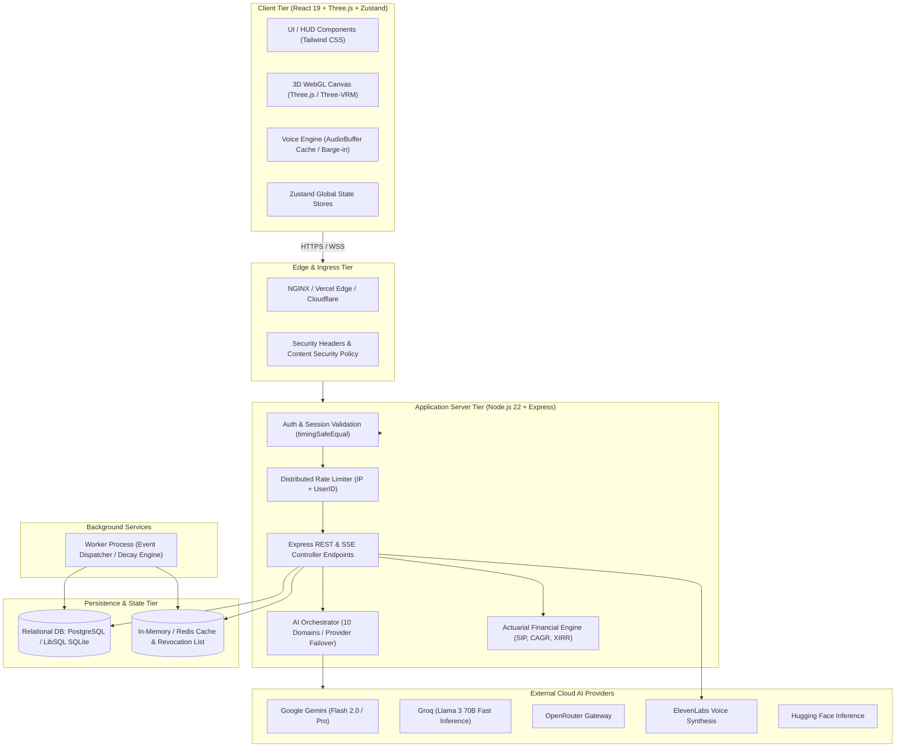

# GF-AI Institutional Platform Architecture

This document defines the high-level system architecture, component boundaries, data pipelines, and operational paradigms of the **GF-AI Platform**.

---

## 1. High-Level System Architecture

---

## 2. Key Architectural Subsystems

### 2.1 AI Orchestration Layer (`aiOrchestrator.ts`)
- **Domain Classifier**: Evaluates user prompts across 10 distinct domains (`crisis`, `financial`, `coding`, `reasoning`, `companionship`, `study_focus`, `creative`, `casual`, `academic`, `world_markets`).
- **Dynamic Provider Failover**: Primary candidate selection follows latency, complexity, and availability heuristics (e.g. Gemini Multi-Key Rotation -> Groq LPU -> OpenRouter -> Hugging Face -> Safe Mock Provider).
- **Latency & Telemetry**: Every LLM call records response latency, token count, and status into internal telemetry registries.

### 2.2 Relational Persistence & Multi-Tenancy (`db/index.ts`)
- **Dual-Engine Architecture**: Dynamically operates on PostgreSQL (production containerized/Kubernetes) or LibSQL/SQLite (serverless/edge/development).
- **Tenant Isolation**: Every database access strictly scopes records by `user_id`.
- **Memory Decay & TTL**: Memory items utilize exponential recency decay with automatic garbage collection of expired short-term context.

### 2.3 3D WebGL Avatar Engine (`VrmAvatar.tsx`)
- **Three-VRM Runtime**: Loads industry-standard humanoid VRM 1.0/0.0 avatars.
- **WebGL Context Resilience**: Features automated recovery handlers for `webglcontextlost` and `webglcontextrestored`.
- **Memory Leak Protection**: Recursively traverses scene graphs upon avatar switches to cleanly invoke `.dispose()` on geometries, materials, and textures.

### 2.4 Voice & Audio Synthesis (`VoiceEngine.ts`)
- **Barge-In Speech Interruption**: Immediate cancellation of in-flight audio playback upon new user speech input.
- **Audio Cache**: SHA-256 keyed in-memory buffer stores frequent speech audio synthesis fragments to minimize external API costs and latency.
- **Voice Fallback**: Gracefully falls back from ElevenLabs neural synthesis to Edge TTS or Web Speech Synthesis.
