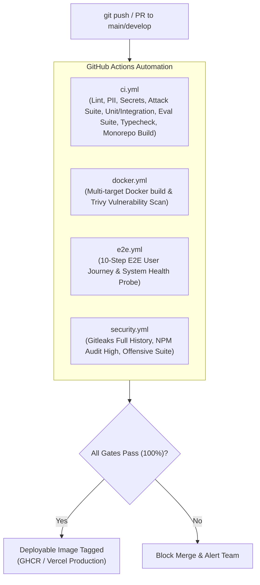

# Continuous Integration & Delivery (CI/CD) Architecture

This document outlines the automated DevOps pipelines, test gates, security scanners, and release mechanisms implemented in GitHub Actions for **GF-AI**.

---

## 1. Pipeline Ecosystem



---

## 2. Active Workflows Overview

| Workflow | Path | Trigger | Core Responsibilities |
|---|---|---|---|
| **Primary CI** | `.github/workflows/ci.yml` | Push & PR (`main`) | Gitleaks, Oxlint, PII & Secrets scanners, Attack Suite (49 tests), SIP math, CORS security, Round 4 integration, Miku voice tests, 121 relationship evals, Monorepo TypeScript compilation |
| **Docker Build** | `.github/workflows/docker.yml` | Push & PR (`main`, `develop`) | Builds `api`, `worker`, and `web` images with Docker Buildx, runs Trivy vulnerability scan |
| **E2E Flow** | `.github/workflows/e2e.yml` | Push, PR, Workflow Dispatch | Tests real 10-step user journeys (health, auth, profile, AI orchestrator, financial computation, character state) |
| **Security Audit** | `.github/workflows/security.yml` | Nightly Cron & Push/PR | Full Git history secret scan, high-severity npm audit, offensive exploitation suite |

---

## 3. Pre-Merge Verification Commands

Developers must run the following checks locally prior to opening a Pull Request:

```bash
# 1. Monorepo Linter
npm run lint

# 2. PII and Secret Scanners
npm run scan:pii
npm run scan:secrets

# 3. Test Suites
npm test
npm run test:e2e
npm run test:evals

# 4. Monorepo Typecheck and Full Build
npm run typecheck
npm run build
```

---

## 4. Branch Protection Rules

Production repositories must configure GitHub branch protection for `main` and `develop` with:
- **Require a pull request before merging**.
- **Require status checks to pass before merging**:
  - `test-and-eval` (Primary CI)
  - `e2e-tests` (E2E Integration Suite)
  - `security-audit` (Security & Compliance)
  - `build-and-scan (api)`
  - `build-and-scan (web)`
  - `build-and-scan (worker)`
- **Require signed commits**.
- **Do not allow bypassing the above settings**.
