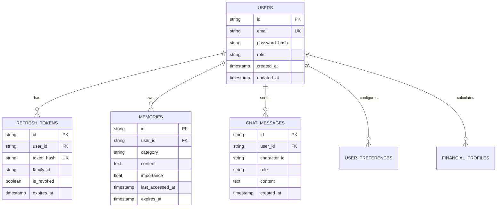

# Database Architecture, Schema & Migrations Guide

This document describes the relational database design, engine compatibility layer, multi-tenant isolation, and migration practices for **GF-AI**.

---

## 1. Dual-Engine Architecture

GF-AI utilizes a polymorphic database adapter designed to operate seamlessly across two distinct operational topologies without changing application code:

| Environment | Engine | Driver | Storage Location |
|---|---|---|---|
| **Containerized / Kubernetes** | PostgreSQL 16 | `pg` (`Pool`) | Remote Cloud RDS / CloudNativePG / Neon |
| **Serverless / Local / Edge** | SQLite / LibSQL | `@libsql/client` | Local file (`/app/data/ada.db` or `os.tmpdir()`) or Turso |

The database initialization automatically detects the environment:
```typescript
if (process.env.DATABASE_URL && process.env.DATABASE_URL.startsWith('postgres')) {
  // Initialize PostgreSQL connection pool with SSL
} else {
  // Initialize LibSQL / SQLite client
}
```

---

## 2. Relational Schema Inventory



---

## 3. Strict Multi-Tenant Isolation

To prevent cross-tenant data leaks:
1. Every query accessing user data **must** enforce `WHERE user_id = :userId` binding.
2. In-memory queries and caches are segmented by `user_id`.
3. Database connection pools run with prepared statements to eliminate SQL injection vulnerabilities.

---

## 4. Indexing Strategy

To guarantee sub-10ms query execution under institutional loads, the following indexes are maintained:
- `idx_users_email`: B-tree index on `users(email)` for instantaneous authentication lookups.
- `idx_refresh_tokens_hash`: Hash index on `refresh_tokens(token_hash)` for O(1) session verification.
- `idx_memories_user_importance`: Compound index on `memories(user_id, importance DESC, last_accessed_at DESC)` for high-speed semantic context assembly.
- `idx_chat_user_character`: Compound index on `chat_messages(user_id, character_id, created_at DESC)` for paginated chat history hydration.

---

## 5. Migrations & Backup Procedures

### PostgreSQL Production Backups
Automated continuous archiving (WAL archiving) and daily snapshots are managed via cloud RDS or Kubernetes volume snapshots.

### Manual Backup Command
```bash
pg_dump -h <HOST> -U <USER> -d gf_ai -F c -b -v -f gf_ai_backup_$(date +%Y%m%d).dump
```

### Restore Command
```bash
pg_restore -h <HOST> -U <USER> -d gf_ai -v gf_ai_backup_20261118.dump
```
