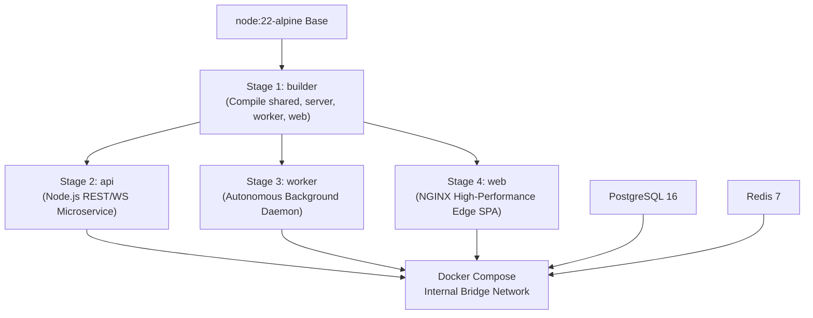

# Docker Containerization & Microservice Orchestration Guide

This document defines the containerization architecture, production build pipeline, and container runtime orchestration for the **GF-AI Institutional Platform**.

---

## 1. Architecture Overview

GF-AI utilizes a **unified multi-stage Dockerfile** supporting target differentiation for independent microservices while sharing common build caching.



### Stage Summary

| Target | Base Image | Non-Root User | Primary Role | Port | Healthcheck |
|---|---|---|---|---|---|
| `builder` | `node:22-alpine` | `root` (build only) | Transpiles TypeScript across all 4 workspaces | N/A | None |
| `api` | `node:22-alpine` | `node` (UID 1000) | REST API, SSE streaming, authentication, LLM proxy | `3001` | `GET /health/live` |
| `worker` | `node:22-alpine` | `node` (UID 1000) | Proactive event dispatching, relationship memory sync | N/A | Process check |
| `web` | `nginx:alpine` | `nginx` | Static asset delivery, SPA routing, reverse proxy | `80` | `GET /` |

---

## 2. Multi-Stage Build & Optimization

The build process is structured to maximize layer caching and minimize production image size:

1. **Manifest Isolation**: Workspace `package.json` manifests are copied first, isolating dependency caching from code edits.
2. **Deterministic Installs**: Builds strictly use `npm ci` ensuring bit-for-bit reproducible node_modules.
3. **Target Pruning**: The production runtime images (`api` and `worker`) execute `npm ci --omit=dev` and purge the npm cache (`npm cache clean --force`), shedding hundreds of megabytes of devDependencies.
4. **Distributable Assets**: The `web` container inherits exclusively the compiled frontend assets (`apps/web/dist`) on lightweight `nginx:alpine` (~25MB total footprint).

---

## 3. Production Service Orchestration (`docker-compose.yml`)

The primary compose topology establishes a complete production-grade local/staging stack:

```yaml
version: '3.8'

services:
  postgres:
    image: postgres:16-alpine
    restart: unless-stopped
    volumes: [pgdata:/var/lib/postgresql/data]
    healthcheck:
      test: ["CMD-SHELL", "pg_isready -U postgres -d gf_ai"]

  redis:
    image: redis:7-alpine
    restart: unless-stopped
    command: ["redis-server", "--appendonly", "yes"]
    volumes: [redisdata:/data]
    healthcheck:
      test: ["CMD", "redis-cli", "ping"]

  api:
    build:
      context: .
      target: api
    ports: ["3001:3001"]
    depends_on:
      postgres: { condition: service_healthy }
      redis: { condition: service_healthy }

  worker:
    build:
      context: .
      target: worker
    depends_on:
      postgres: { condition: service_healthy }
      redis: { condition: service_healthy }
      api: { condition: service_healthy }

  web:
    build:
      context: .
      target: web
    ports: ["80:80", "3000:80"]
    depends_on:
      api: { condition: service_healthy }
```

### Zero-Insecure Secrets Guarantee
In compliance with production security standards, `docker-compose.yml` does **not** inject hardcoded secrets or fallbacks for critical security variables:
- `JWT_SECRET=${JWT_SECRET:?JWT_SECRET must be set}`
- `REFRESH_SECRET=${REFRESH_SECRET:?REFRESH_SECRET must be set}`
- `POSTGRES_PASSWORD=${POSTGRES_PASSWORD:?POSTGRES_PASSWORD must be set in environment}`

---

## 4. Local Development Stack (`docker-compose.dev.yml`)

For rapid interactive development without rebuilding container images on every code edit, activate the development overlay:

```bash
docker compose -f docker-compose.yml -f docker-compose.dev.yml up
```

Features:
- Source directories (`packages/shared`, `apps/server`, `apps/worker`, `apps/web`) are volume mounted into the containers.
- Hot-reloading is driven by `tsx watch` (backend/worker) and Vite HMR (frontend on port `5173`).
- Isolated container `node_modules` volumes prevent host OS file-locking collisions.

---

## 5. Observability Topology (`docker-compose.observability.yml`)

To monitor application telemetry, Prometheus, Grafana, Loki, and Promtail are orchestrated alongside the primary services:

```bash
docker compose -f docker-compose.yml -f docker-compose.observability.yml up -d
```

- **Prometheus** (`:9090`): Automatically scrapes metrics from `http://api:3001/metrics` every 15 seconds.
- **Grafana** (`:3002`): Visualizes API latency, HTTP throughput, and memory consumption.
- **Loki** (`:3100`): Ingests structured JSON logs emitted by container runtimes.
- **Promtail** (`:9080`): Taps Docker daemon container logs and forwards them to Loki.

---

## 6. Stack Verification Procedures

To verify image definitions, stage boundaries, and compose configurations:

**Linux / macOS:**
```bash
bash scripts/docker/verify-stack.sh
```

**Windows PowerShell:**
```powershell
.\scripts\docker\verify-stack.ps1
```

**Automated CI/Node Test:**
```bash
node scripts/docker/verify_docker_compose.mjs
```
