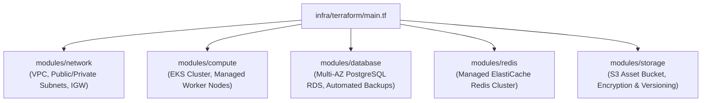

# Infrastructure as Code (IaC) & Cloud Architecture

This document describes the modular Terraform infrastructure provisioning for **GF-AI**, covering VPC networks, managed databases, caching clusters, compute engines, and cloud object storage.

---

## 1. Modular Topology

The Terraform architecture in `infra/terraform/` isolates cloud primitives into reusable, independently testable modules:



---

## 2. Module Specifications

### `modules/network`
- Allocates a non-overlapping CIDR block (default `10.0.0.0/16`).
- Establishes 2 public subnets for edge ingress load balancers.
- Establishes 2 private subnets for compute worker nodes and databases.
- Deploys an Internet Gateway and route tables.

### `modules/compute`
- Provisions an AWS EKS Kubernetes cluster.
- Configures IAM cluster roles with `AmazonEKSClusterPolicy`.
- Spawns auto-scaling worker node groups (`t4g.large` Graviton instances for high cost-efficiency and performance).
- Implements least-privilege node IAM roles (`AmazonEKSWorkerNodePolicy`, `AmazonEKS_CNI_Policy`, `AmazonEC2ContainerRegistryReadOnly`).

### `modules/database`
- Provisions PostgreSQL 16 on Amazon RDS.
- Configures DB subnet groups strictly in private subnets.
- Enables Multi-AZ replication in production environments.
- Automatically generates high-entropy 32-character master credentials via `random_password`.
- Configures AES-256 storage encryption at rest.

### `modules/redis`
- Provisions an ElastiCache Redis 7.0 caching and pub/sub cluster in private subnets.
- Dedicated to session revocation tracking, rate-limiting tokens, and worker job synchronization.

### `modules/storage`
- Creates an Amazon S3 bucket for storing 3D avatar assets (.vrm files) and generated audio voice caches.
- Enforces default AES-256 server-side encryption.
- Enforces bucket versioning for asset recovery.

---

## 3. Provisioning Workflow

### 1. Initialize Backend & Providers
```bash
cd infra/terraform
terraform init
```

### 2. Configure Environment Variables
Copy the variable template:
```bash
cp terraform.tfvars.example terraform.tfvars
```
Adjust `environment`, `region`, and `kubernetes_node_count` as required.

### 3. Generate Execution Plan
```bash
terraform plan -out=tfplan
```

### 4. Apply Infrastructure
```bash
terraform apply tfplan
```

### 5. Automated Verification
```bash
node ../../scripts/infra/verify_terraform.mjs
```
