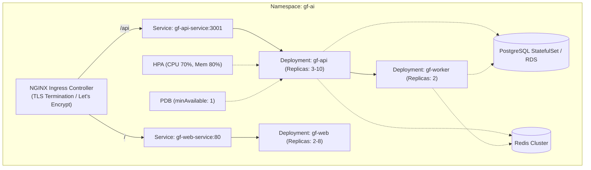

# Kubernetes Platform Architecture & Operations Guide

This guide establishes the production-grade Kubernetes architecture, manifests, probe standards, security posture, and autoscaling policies for **GF-AI**.

---

## 1. Cluster Architecture & Topography

The GF-AI platform operates across three decoupled service layers within the isolated `gf-ai` namespace:



---

## 2. Manifest Inventory (`infra/kubernetes/`)

| Manifest | Kind | Purpose |
|---|---|---|
| `namespace.yaml` | `Namespace` | Creates isolated `gf-ai` tenant namespace |
| `configmap.yaml` | `ConfigMap` | Non-sensitive runtime variables (`NODE_ENV`, `PORT`, `CORS_ORIGIN`, models) |
| `secrets-template.yaml` | `Secret` | Template for credentials, token signing keys, and external API tokens |
| `api-deployment.yaml` | `Deployment` | Main backend API server with probes and non-root security context |
| `api-service.yaml` | `Service` | Internal ClusterIP exposing port `3001` |
| `api-hpa.yaml` | `HorizontalPodAutoscaler` | Dynamic autoscaling between 2 and 10 pods |
| `api-pdb.yaml` | `PodDisruptionBudget` | High-availability guarantee preserving at least 1 replica during cluster drain |
| `worker-deployment.yaml` | `Deployment` | Background autonomous task dispatcher |
| `web-deployment.yaml` | `Deployment` | NGINX Edge SPA frontend serving compiled assets |
| `web-service.yaml` | `Service` | Internal ClusterIP exposing port `80` |
| `web-hpa.yaml` | `HorizontalPodAutoscaler` | Frontend autoscaling between 2 and 8 pods |
| `ingress.yaml` | `Ingress` | TLS ingress routing `/api` to API service and `/` to frontend |
| `network-policy.yaml` | `NetworkPolicy` | Zero-trust firewall restricting namespace traffic and egress |
| `service-account.yaml` | `ServiceAccount` | Least-privilege service identity |
| `rbac.yaml` | `Role` & `RoleBinding` | Read-only configuration access for app pod identity |

---

## 3. High Availability, Probes & Resilience

### Health & Liveness Probes
Every API pod exposes dedicated diagnostic endpoints designed for Kubernetes orchestrators:
- **Liveness Probe**: `httpGet: /health/live` on port `3001` (validates Node.js event loop health; fails if process deadlocks).
- **Readiness Probe**: `httpGet: /health/ready` on port `3001` (validates downstream database and state availability before accepting traffic from service endpoints).

### Rolling Updates & Zero-Downtime
```yaml
strategy:
  type: RollingUpdate
  rollingUpdate:
    maxSurge: 1
    maxUnavailable: 0
```
This guarantees that new pods are fully initialized and pass their readiness checks before old pods are terminated.

### Pod Disruption Budget
The `api-pdb.yaml` guarantees that during scheduled cluster maintenance, node draining, or cluster upgrades, `minAvailable: 1` (or 2 in production) pods will remain operational.

---

## 4. Hardened Security Context

Containers execute with strict Linux namespace hardening:
```yaml
securityContext:
  runAsNonRoot: true
  runAsUser: 1000
  runAsGroup: 1000
  fsGroup: 1000
  allowPrivilegeEscalation: false
  capabilities:
    drop:
      - ALL
```
Root execution is strictly prohibited. Capabilities are stripped to zero.

---

## 5. Deployment Procedures

### 1. Apply Namespace & RBAC
```bash
kubectl apply -f infra/kubernetes/namespace.yaml
kubectl apply -f infra/kubernetes/service-account.yaml
kubectl apply -f infra/kubernetes/rbac.yaml
```

### 2. Configure Environment & Secrets
```bash
kubectl apply -f infra/kubernetes/configmap.yaml
# Copy secrets-template.yaml to secrets.yaml, populate production keys, then:
kubectl apply -f infra/kubernetes/secrets.yaml
```

### 3. Deploy Workloads & Services
```bash
kubectl apply -f infra/kubernetes/api-deployment.yaml
kubectl apply -f infra/kubernetes/api-service.yaml
kubectl apply -f infra/kubernetes/worker-deployment.yaml
kubectl apply -f infra/kubernetes/web-deployment.yaml
kubectl apply -f infra/kubernetes/web-service.yaml
```

### 4. Enable Autoscaling & Traffic Ingress
```bash
kubectl apply -f infra/kubernetes/api-hpa.yaml
kubectl apply -f infra/kubernetes/api-pdb.yaml
kubectl apply -f infra/kubernetes/web-hpa.yaml
kubectl apply -f infra/kubernetes/network-policy.yaml
kubectl apply -f infra/kubernetes/ingress.yaml
```

### 5. Verify Rollout
```bash
kubectl rollout status deployment/gf-api -n gf-ai
kubectl rollout status deployment/gf-web -n gf-ai
kubectl get hpa -n gf-ai
```
