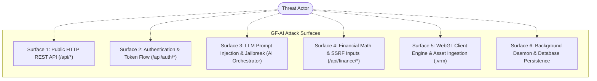

# Comprehensive Security Threat Model & Risk Analysis

This document defines the formal threat model for **GF-AI**, analyzing threat actors, attack surfaces, vulnerability vectors using the **STRIDE** methodology, and corresponding architectural mitigations.

---

## 1. System Attack Surfaces

---

## 2. STRIDE Threat Assessment

### 1. Spoofing Identity
- **Threat**: Attacker attempts to forge JWT authentication tokens or assume administrator privileges.
- **Implemented Mitigation**:
  - Cryptographic verification with 256-bit HMAC secret keys.
  - Constant-time secret token verification via `crypto.timingSafeEqual` prevents side-channel timing attacks.
  - Strict role assignment: Administrator role is **never** accepted from request bodies or client claims; it is derived exclusively from the server-side `ADMIN_EMAILS` environment allowlist.
  - Refresh token family rotation with automated reuse detection immediately invalidates the entire token family upon duplicate presentation.

### 2. Tampering with Data
- **Threat**: Modification of financial calculations, user profile memory, or unauthorized access to another user's conversational state.
- **Implemented Mitigation**:
  - All database queries enforce strict tenant/user scoping: `WHERE user_id = :userId`.
  - Comprehensive runtime schema validation with **Zod** (`zod@4.x`) sanitizes and strips unknown payload fields.
  - Financial SIP calculators enforce actuarial floor/ceiling bounds on inputs (e.g. rate between 0% and 100%, tenure between 1 and 50 years).

### 3. Repudiation
- **Threat**: User or compromised administrator denies performing administrative actions, altering memory, or invoking operations.
- **Implemented Mitigation**:
  - Detailed audit logs capture caller IP, timestamp, user ID, route, and action parameters for all sensitive operations.
  - Administrative operations emit dedicated security audit events.

### 4. Information Disclosure
- **Threat**: Exposure of PII, leaked API keys, database connection strings, or system environment variables.
- **Implemented Mitigation**:
  - Multi-tier PII and entropy scanners run on every commit (`scan_pii.mjs`, `scan_secrets.mjs`, Gitleaks).
  - Production error handlers emit generic client responses (`"Internal Server Error"`) with no stack traces or internal filenames.
  - `/api/health` returns sanitized status without revealing infrastructure topology.
  - Strict Content Security Policy (CSP) headers without `'unsafe-inline'` prevents script exfiltration.

### 5. Denial of Service (DoS)
- **Threat**: Algorithmic DoS, event loop starvation, excessive LLM API quota exhaustion, or WebGL GPU crashes.
- **Implemented Mitigation**:
  - Distributed rate limiting via `express-rate-limit` keyed by combined IP + User ID.
  - Express JSON body parsers strictly limit incoming payload sizes (`limit: '10mb'`).
  - WebGL context loss listeners and deep texture disposal prevent client memory crashes.
  - AI Orchestrator enforces token ceilings and multi-provider failover.

### 6. Elevation of Privilege
- **Threat**: Unauthenticated visitor gaining access to authenticated or administrative endpoints.
- **Implemented Mitigation**:
  - Standardized Express authentication middleware (`authMiddleware`) applied to all protected API routes.
  - Zero unauthenticated backdoor routes.
  - Attack regression suite (`scripts/security/attack_suite.mjs`) executes 49 automated offensive exploit attempts in CI, verifying that all attack vectors are blocked with HTTP 401/403.

---

## 3. Cryptographic Standards Summary

| Primitives | Implementation | Specification |
|---|---|---|
| Password / Hash Storage | PBKDF2 / SHA-256 | High-iteration cryptographic hashing |
| Session Token Signing | HMAC-SHA256 | High-entropy secrets (min 32 bytes) |
| Token Comparison | `crypto.timingSafeEqual` | Eliminates timing side-channels |
| HTTPS / TLS | TLS 1.3 / TLS 1.2 | Perfect Forward Secrecy with modern cipher suites |
| Object Storage Encryption | AES-256 (SSE-S3) | Encrypted at rest |
